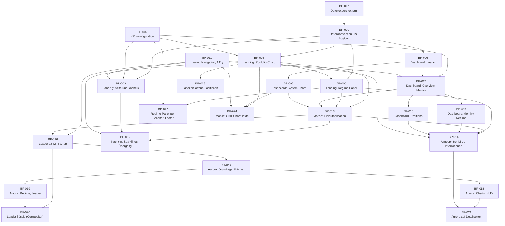

# build_plan.md – Wealth-Lab Meta-Portfolio

| Eigenschaft | Wert |
|---|---|
| Dokumenttyp | SDD – Build-Plan |
| Modus | INIT (Reverse-Dokumentation) |
| Stand | 2026-10-26 |
| Bezug | `project_plan.md` (Anforderungen), `decisions.md` (Entscheidungen), `agents.md` (Arbeitsregeln) |

## 1. Lesehinweise

### 1.1 Charakter dieses Build-Plans

Das Projekt besteht bereits. Dieser Build-Plan ist deshalb **retrospektiv**: Er gliedert den vorhandenen Code in nachvollziehbare Arbeitspakete, damit künftige Aufträge (`PLAN BP-xxx`, `IMPLEMENT BP-xxx`, `VALIDATE BP-xxx`) einen klaren Zuschnitt haben. Die Pakete beschreiben keine neuen Funktionen.

Der Build-Plan darf `project_plan.md` und `decisions.md` nicht fachlich überschreiben. Er darf nicht nachträglich so geändert werden, dass nicht geplante Implementierungen legitimiert werden.

### 1.2 Statuswerte

| Status | Bedeutung |
|---|---|
| **Umgesetzt (Ist)** | Der Code im Repository setzt den Scope um. **Nicht validiert**, weil keine Tests existieren (D-024) und noch keine VALIDATE-Läufe stattfanden. |
| **Extern** | Liegt ausserhalb des Repositorys; nicht prüfbar. |
| **Offen** | Nicht begonnen. Aktuell kein Paket mit diesem Status; Änderungswünsche stehen in Kapitel 4 als Kandidaten ohne Freigabe. |

### 1.3 Definition of Done

Das Projekt definiert keine eigene Definition of Done. Es gilt der SDD-Standard:

1. definierter Scope umgesetzt,
2. keine unbeabsichtigte Funktionserweiterung,
3. betroffene bestehende Funktionen weiterhin konsistent,
4. technische Abhängigkeiten berücksichtigt,
5. relevante Fehlerfälle behandelt, sofern spezifiziert,
6. vorhandene Validierungen erfolgreich (hier: manuelle Prüfliste aus `agents.md`),
7. SDD und Implementierung nicht widersprüchlich,
8. relevante Entscheidungen eingehalten,
9. keine unbegründeten TODOs oder Platzhalter.

---

## 2. Abhängigkeitsübersicht

Die Pfeilrichtung bedeutet "ist Voraussetzung für". Die Reihenfolge entspricht der logischen Baufolge, nicht der Entstehungsgeschichte (nicht rekonstruierbar ohne tiefere Git-Analyse).

---

## 3. Arbeitspakete

### BP-001 – Datenkonvention und Systemregister

| | |
|---|---|
| **Status** | Umgesetzt (Ist), nicht validiert |
| **Ziel** | Einheitliche Ablage der Systemdaten und ein Register, das die Landing-Seite steuert. |
| **Scope** | Ordner `systems/<slug>/` mit vier JSON-Dateien; `js/systems.js` mit `window.SYSTEMS`; Ablauf "Neues System hinzufügen". |
| **Nicht im Scope** | Erzeugung der JSON-Dateien (BP-012); Anzeige-Logik. |
| **Voraussetzungen** | BP-012 liefert die Dateien. |
| **Betroffene Dateien** | `js/systems.js`, `systems/**`, `README.md` |
| **Anforderungen / Decisions** | `project_plan.md` 5.1 bis 5.6, 12.3; D-004, D-005, D-007 |
| **Umsetzungsschritte (Ist)** | 1. Ordner je System. 2. Vier Dateien nach Konvention. 3. Eintrag `{ id, dataPath }`. |
| **Abschlusskriterien** | a) Jedes registrierte System hat alle vier Dateien. b) `id` entspricht dem Ordnernamen und dem Slug-Muster `^[a-z0-9-]+$`. c) `dataPath` zeigt auf den Ordner. d) JSON ist lesbar (NaN toleriert, siehe D-009). |
| **Bekannte Abweichungen** | INC-01, INC-06 (zwei nicht registrierte Ordner), OP-03, OP-04 |

### BP-002 – KPI-Konfiguration und Ampellogik

| | |
|---|---|
| **Status** | Umgesetzt (Ist), nicht validiert |
| **Ziel** | Zentrale Regeln für Farbe, Trophäe und Anzeigeschalter. |
| **Scope** | `WL_KPI_CONFIG` (`colors`, `display`, `metrics`); `getKpiPresentation`. |
| **Voraussetzungen** | keine |
| **Betroffene Dateien** | `js/kpi-config.js` |
| **Anforderungen / Decisions** | `project_plan.md` Kapitel 9; D-015, D-016 |
| **Umsetzungsschritte (Ist)** | Konfigurationsobjekt; Regelauswertung "erste zutreffende Regel"; Abbildung auf Landing- und Dashboard-Klassen. |
| **Abschlusskriterien** | a) Jeder in Landing und Dashboard verwendete `metricKey` hat Regeln und einen Default (Regel ohne `op`). b) Unbekannter Schlüssel oder nicht numerischer Wert ergibt neutral. c) Beide Oberflächen liefern konsistente Klassen. |
| **Bekannte Abweichungen** | INC-10, OP-07, OP-12 |

### BP-003 – Landing-Seite: Seitengerüst und Systemkacheln

| | |
|---|---|
| **Status** | Umgesetzt (Ist), nicht validiert |
| **Ziel** | Einstiegsseite mit Systemübersicht. |
| **Scope** | `index.html` (SEO, Loader, Portfolio-Block, Kachelraster, Footer, Skript-Lader); `landing.js` (Loader, Kacheln, Fehlerkacheln, Tilt); `landing.css`. |
| **Nicht im Scope** | Portfolio-Chart (BP-004), Regime-Panel (BP-005). |
| **Voraussetzungen** | BP-001, BP-002, BP-011 |
| **Betroffene Dateien** | `index.html`, `js/landing.js`, `css/landing.css` |
| **Anforderungen / Decisions** | FR-L-01, FR-L-09 bis FR-L-13; D-007, D-009, D-010, D-020, D-025 |
| **Umsetzungsschritte (Ist)** | Skripte sequenziell laden; `renderSystems` parallel für alle Systeme; Karte oder Fehlerkarte; Tilt ab 701 px. |
| **Abschlusskriterien** | a) Pro registriertem System genau eine Kachel mit Link auf `./dashboard/index.html?system=<id>`. b) Fehlerhafte Daten erzeugen eine Fehlerkachel, andere Kacheln bleiben. c) Leeres Register zeigt Hinweistext. d) Loader verschwindet nach Abschluss. |
| **Bekannte Abweichungen** | INC-04, INC-05, INC-11, INC-18, OP-09 |

### BP-004 – Landing-Seite: Portfolio-Equity-Chart und Portfolio-KPIs

| | |
|---|---|
| **Status** | Umgesetzt (Ist), nicht validiert |
| **Ziel** | Aggregierte Portfolio-Kurve mit Kennzahlen und Interaktion. |
| **Scope** | Laden aller Equity-/Positionsdateien, Normalisierung, Datumsachse, Carry-Forward, Aggregation, laufende Werte, KPI-Karten, SVG, Tooltip, Zoom/Pan/Touch/Reset, Statuszeile. |
| **Nicht im Scope** | Regime-Panel (BP-005). |
| **Voraussetzungen** | BP-001, BP-002 |
| **Betroffene Dateien** | `js/equity-overview-chart.js`, `css/landing.css` (Chart, KPI-Karten) |
| **Anforderungen / Decisions** | FR-L-02 bis FR-L-07; `project_plan.md` 8.1 bis 8.4; D-010, D-011, D-012, D-013, D-014, D-015, D-017 |
| **Umsetzungsschritte (Ist)** | `loadAllSystemEquitySeries` → `buildUnifiedDateAxis` → `aggregatePortfolioSeries` → `renderEquityOverviewChart` → Zoom-Zustand und Events → `calculatePortfolioKpis` → Karten. |
| **Abschlusskriterien** | a) Statuszeile zeigt `<geladen>/<gesamt> systems included`. b) Chart zeigt Equity, Drawdown, Jahreslabels. c) Tooltip zeigt neun Werte. d) Zoom bleibt in den Grenzen der Daten, Mindestspanne 30 Tage. e) Ohne Daten erscheint der Leerzustand statt eines Fehlers. f) KPI-Karten folgen `showPortfolioOverviewKpis` und `useDisplayEquity`. |
| **Bekannte Abweichungen** | INC-08, INC-13, INC-14, OP-06, OP-12 |

### BP-005 – Landing-Seite: Risk-Regime-Panel

| | |
|---|---|
| **Status** | Umgesetzt (Ist), nicht validiert |
| **Ziel** | Marktregime-Verlauf unter dem Portfolio-Chart. |
| **Scope** | Laden und Normalisieren der beiden Regime-Dateien, Zeitraumfilter über `_wlPortfolioTimeRange`, Zustandsbänder, Composite- und Stretch-Linie, End-Label, Tooltip, Legende. |
| **Voraussetzungen** | BP-001; BP-004 (setzt `_wlPortfolioTimeRange`) |
| **Betroffene Dateien** | `js/regime-engine-chart.js`, `js/landing.js` (Aufruf), `index.html` (Panel, Tooltip), `css/landing.css` |
| **Anforderungen / Decisions** | FR-L-08; `project_plan.md` 5.5, 8.7; D-011, D-018 |
| **Abschlusskriterien** | a) Fehlen beide Dateien, erscheint "Regime data unavailable". b) Zustandsbänder entsprechen der Zuordnung in `STATE_COLORS`. c) Stretch-Element folgt `showRegimeStretchScore`. d) Zeitachse entspricht dem Gesamtzeitraum des Portfolio-Charts. |
| **Bekannte Abweichungen** | INC-08, INC-09, INC-17 |

### BP-006 – Dashboard: Loader und URL-Routing

| | |
|---|---|
| **Status** | Umgesetzt (Ist), nicht validiert |
| **Ziel** | System über URL wählen, Daten laden, Renderer starten, Fehler anzeigen. |
| **Scope** | URL-Parameter, Slug-Validierung, paralleles Laden der vier Dateien, NaN-Bereinigung, Mindestanzeigedauer des Loaders, Fehleranzeige in Kopf und Panels. |
| **Voraussetzungen** | BP-001 |
| **Betroffene Dateien** | `js/dashboard-loader.js`, `dashboard/index.html` (Loader-Overlay) |
| **Anforderungen / Decisions** | FR-D-01 bis FR-D-03, FR-D-12; D-006, D-008, D-009, D-010 |
| **Abschlusskriterien** | a) Fehlender oder ungültiger Parameter zeigt die definierte Meldung. b) Fehlende Datei zeigt `Could not load file: <pfad> (<status>)`. c) Erfolgreicher Aufruf ruft `bootDashboard` genau einmal mit dem Payload auf. d) Loader wird in allen Pfaden ausgeblendet. |
| **Bekannte Abweichungen** | INC-07, INC-08, INC-15, INC-16, OP-10 |

### BP-007 – Dashboard: Rendering Overview und Metrics Report

| | |
|---|---|
| **Status** | Umgesetzt (Ist), nicht validiert |
| **Ziel** | Kopfbereich, Tabs, Kennzahlenkarten und -tabellen. |
| **Scope** | `normalizeCurrentState`, Kopf (Titel, Info, Meta), Tabs und Hamburger, Overview-Karten und -Tabelle, Metrics-Tabelle, Karten-Tooltip, `renderError`. |
| **Voraussetzungen** | BP-002, BP-006, BP-011 |
| **Betroffene Dateien** | `js/main.js`, `dashboard/index.html`, `css/styles.css` |
| **Anforderungen / Decisions** | FR-D-04 bis FR-D-07, FR-D-11; `project_plan.md` 5.2, 7.1; D-006, D-007, D-015, D-016, D-021, D-022 |
| **Abschlusskriterien** | a) Neun Karten, 13 Overview-Zeilen, 21 Metrics-Zeilen. b) Fehlende Werte erscheinen als "-". c) Farbe und Trophäe stammen aus `getKpiPresentation`. d) Tab-Wechsel zeigt genau ein Panel. |
| **Bekannte Abweichungen** | INC-10, INC-11, INC-12, INC-19 |

### BP-008 – Dashboard: System-Equity-Chart

| | |
|---|---|
| **Status** | Umgesetzt (Ist), nicht validiert |
| **Ziel** | Equity- und Drawdown-Kurve je System. |
| **Scope** | Normalisierung, Log-Skala, dynamische Drawdown-Achse, Cash-Zonen, Jahreslabels, Tooltip (Maus/Touch), schmales Layout, `ResizeObserver`. |
| **Voraussetzungen** | BP-006, BP-002 (Divisor) |
| **Betroffene Dateien** | `js/equity-system-chart.js` |
| **Anforderungen / Decisions** | FR-D-08; `project_plan.md` 8.6; D-011, D-012, D-015 |
| **Abschlusskriterien** | a) Weniger als zwei Punkte zeigen "Not enough equity data available.". b) Drawdown-Achse deckt den tiefsten Drawdown ab. c) Neuzeichnen bei Breitenänderung ohne Mehrfach-Observer. |
| **Bekannte Abweichungen** | keine eigenen |

### BP-009 – Dashboard: Monthly Returns

| | |
|---|---|
| **Status** | Umgesetzt (Ist), nicht validiert |
| **Ziel** | Monatsrenditen-Matrix mit Jahres- und Durchschnittswerten. |
| **Scope** | `buildMonthlyMatrix`, `calcAnnual`, `renderMonthlyReturns`. |
| **Voraussetzungen** | BP-007 (globale Hilfsfunktionen aus `main.js`) |
| **Betroffene Dateien** | `js/monthly-returns.js`, `css/styles.css` (`.mr-*`) |
| **Anforderungen / Decisions** | FR-D-09; `project_plan.md` 8.5 |
| **Abschlusskriterien** | a) Ohne mindestens zwei Monate erscheint "Not enough equity data for monthly returns.". b) Jahresrendite entspricht der Aufzinsung der Monatswerte. c) Trades pro Monat nur bei `positionCount > 0`. |
| **Bekannte Abweichungen** | keine eigenen; Kopplung an `main.js` beachten (`project_plan.md` 4.4) |

### BP-010 – Dashboard: Positions

| | |
|---|---|
| **Status** | Umgesetzt (Ist), nicht validiert |
| **Ziel** | Positionstabelle mit Sortierung. |
| **Scope** | `renderPositions`, `renderPositionsRows`, Sortierlogik für `entryDate`, `exitDate`, `plPercent`, Days Held, Mobile-Spalten. |
| **Voraussetzungen** | BP-007 |
| **Betroffene Dateien** | `js/main.js`, `dashboard/index.html`, `css/styles.css` |
| **Anforderungen / Decisions** | FR-D-10; `project_plan.md` 7.1 |
| **Abschlusskriterien** | a) Leere Liste zeigt "No positions available.". b) Offene Positionen zeigen "Open" und rechnen Days Held bis heute. c) Wiederholter Klick auf eine Spalte kehrt die Richtung um; Pfeil nur an der aktiven Spalte. d) Preisspalten sind auf Mobile ausgeblendet. |
| **Bekannte Abweichungen** | INC-15 |

### BP-011 – Layout, Navigation und Barrierefreiheit

| | |
|---|---|
| **Status** | Umgesetzt (Ist), nicht validiert |
| **Ziel** | Einheitliche, responsive Darstellung und Bedienbarkeit. |
| **Scope** | Design-Tokens, Kopfbereich, Tabs/Hamburger, Karten, Tabellen, Loader-Overlay, Breakpoints, `prefers-reduced-motion`, ARIA-Attribute. |
| **Voraussetzungen** | keine |
| **Betroffene Dateien** | `css/styles.css`, `css/landing.css`, `index.html`, `dashboard/index.html` |
| **Anforderungen / Decisions** | `project_plan.md` 10.1 bis 10.4; D-019, D-020, D-021 |
| **Abschlusskriterien** | a) Darstellung unterhalb und oberhalb der Breakpoints 700 px, 768 px und 1280 px ohne horizontales Überlaufen der Hauptbereiche. b) Alle interaktiven Elemente des Dashboards sind per Tastatur erreichbar, soweit im Ist vorgesehen. c) Animationen entfallen bei `prefers-reduced-motion`. |
| **Bekannte Abweichungen** | D-021 (Landing-Tooltips nur per Hover), D-019 (doppelte `:root`-Blöcke) |

### BP-012 – Datenexport aus Wealth-Lab nach `systems/**`

| | |
|---|---|
| **Status** | Extern, nicht prüfbar |
| **Ziel** | Erzeugung und Veröffentlichung der JSON-Dateien. |
| **Scope** | Export von `wl-*.json`, Regime-Dateien, automatischer Commit `Auto update trading dashboard <Zeitstempel>`. |
| **Hinweis** | Nicht Teil dieses Repositorys. Das Paket steht hier nur, damit die Abhängigkeit sichtbar ist. Schnittstelle zum Repository ist ausschliesslich das Datenformat aus `project_plan.md` Kapitel 5. |
| **Abschlusskriterien** | nicht definierbar ohne Information (OP-01) |

### BP-013 – Motion: Einlaufanimation von Charts und Kennzahlen

| | |
|---|---|
| **Status** | Umgesetzt (2026-10-26) und im Browser geprüft (Chrome headless, Echtzeit, siehe "Prüfung"); nicht geprüft in anderen Browsern und auf echten Mobilgeräten |
| **Ziel** | Charts zeichnen sich beim Öffnen ein, Kennzahlen zählen hoch (Vorschlag 1 "Daten zum Leben erwecken"). |
| **Scope** | Neue Dateien `css/motion.css` und `js/motion.js` (`WL_MOTION`); Markup-Ergänzungen im Portfolio-Chart, Regime-Panel, System-Chart; Hochzählen in `createKpiCard` (Landing) und `renderOverview` (Dashboard); Einbindung in `index.html` (Skriptliste, Stylesheet) und `dashboard/index.html`. |
| **Nicht im Scope** | Vorschläge 2 und 3; Änderung von Berechnungen, Formaten, KPI-Regeln, Loader-Vertrag; globale Reduced-Motion-Regel für `landing.css` (INC-20). |
| **Voraussetzungen** | BP-004, BP-005, BP-007, BP-008 (betroffene Render-Funktionen) |
| **Betroffene Dateien** | `css/motion.css` (neu), `js/motion.js` (neu), `js/equity-overview-chart.js`, `js/regime-engine-chart.js`, `js/equity-system-chart.js`, `js/main.js`, `index.html`, `dashboard/index.html` |
| **Anforderungen / Decisions** | FR-M-01 bis FR-M-07; D-026; D-001, D-011, D-019, D-025 |
| **Umsetzungsschritte** | 1. `motion.js`: `wl-motion`-Klasse (nicht bei Reduced-Motion), Bereitschaft über `#pageLoader` (`hidden`, Fallback 8 s), `countUp`. 2. `motion.css`: Keyframes und Klassen `wl-draw-line`, `wl-fade-in`, `wl-trophy-pop`. 3. Markup der drei Charts ergänzen, nur beim Erstrendern. 4. Hochzählen und Trophäen-Pop in den Kennzahlenkarten. 5. Einbindung in beide HTML-Seiten. |
| **Abschlusskriterien** | a) Erstaufruf: Linie zeichnet sich nach dem Loader ein, KPIs zählen hoch, Endwerte identisch zu vorher. b) Zoom, Pan, Reset und Resize lösen keine neue Einzeichnung aus. c) System-Chart zeichnet sich beim ersten Öffnen des Tabs ein. d) Bei `prefers-reduced-motion: reduce` und ohne `motion.js` erscheint der Endzustand sofort. e) Fehlende Daten verhalten sich wie bisher (Fehlerkachel, Leerzustand). f) Konsole ohne neue Fehler. |
| **Bekannte Abweichungen** | INC-20 (nicht Teil des Pakets) |
| **Prüfung (2026-10-26)** | **Erfüllt** (Chrome headless über DevTools-Protokoll, Echtzeit, Server lokal): a) Loader ausgeblendet nach ca. 0,7 s, danach Einzeichnung (Offset 1 → 0 in ca. 1,4 s) und Hochzählen; Endwerte Landing `41.75% / 3192% / -13.79% / 2.29 / 2.33 / 65.65%` und Dashboard `45.32% / 4120% / -33.47% / 25.90 / 1.29 / 1.35 / 44.30 / 66.67% / 4` sind identisch mit dem Lauf bei `prefers-reduced-motion`. b) Mausrad-Zoom auf dem Portfolio-Chart erzeugt die Linie ohne Motion-Klasse; Fenstergrösse 900 px und 390 px zeichnet den System-Chart ohne Motion-Klasse neu. c) System-Chart animiert beim ersten Öffnen des Tabs (Offset 0,99 → 0 in ca. 1,5 s). d) Mit `--force-prefers-reduced-motion` setzt `motion.js` keine Klassen, Endwerte erscheinen sofort. f) Keine Konsolenfehler. **Nicht prüfbar / offen:** e) Fehlerfälle (fehlende Daten) nicht gezielt provoziert; Firefox, Safari und echte Touch-Geräte nicht getestet; Touch-Zoom nicht getestet. |

### BP-014 – Motion: Atmosphäre und Mikro-Interaktionen

| | |
|---|---|
| **Status** | Umgesetzt (2026-10-26) und im Browser geprüft (Chrome headless, Echtzeit, siehe "Prüfung"); nicht geprüft in anderen Browsern und auf echten Mobilgeräten |
| **Ziel** | Lebendiger Hintergrund und modernere Dashboard-Interaktionen (Vorschlag 3). |
| **Scope** | Hintergrund-Drift, Regime-Tint (Landing), gleitender Tab-Indikator, Heatmap und gestaffeltes Einblenden bei Monthly Returns, gestaffelte Positionszeilen, kürzerer Panelwechsel. |
| **Nicht im Scope** | Vorschlag 2 (Kacheln, Sparklines, Seitenübergang); FLIP-Umordnung der Positionstabelle; Änderung von Berechnungen, Formaten, Regeln. |
| **Voraussetzungen** | BP-013 (`motion.js`, `motion.css`), BP-005, BP-009, BP-010, BP-011 |
| **Betroffene Dateien** | `css/motion.css`, `js/motion.js`, `css/styles.css`, `js/regime-engine-chart.js`, `js/main.js`, `js/monthly-returns.js` |
| **Anforderungen / Decisions** | FR-M-08 bis FR-M-13; D-027; D-026, D-019 |
| **Umsetzungsschritte** | 1. `motion.js`: `setRegime`, `initTabIndicator`. 2. `motion.css`: Drift, `.wl-ambient`, Tab-Indikator, `wl-stagger-in`. 3. `regime-engine-chart.js`: letzten Zustand melden. 4. `main.js`: Indikator initialisieren, Zeilen staffeln. 5. `monthly-returns.js` und `styles.css`: Heatmap. 6. `styles.css`: `panelFadeIn` 350 ms. |
| **Abschlusskriterien** | a) Drift läuft nur ab 701 px und mit `wl-motion`; Leerlauf ohne dauerhaft hohe Last. b) Landing färbt gemäss letztem Composite-Zustand; Neutral ohne Färbung. c) Tab-Indikator gleitet bei Tab-Wechsel, entfällt unter 769 px, Hamburger-Menü unverändert. d) Heatmap zeigt Intensität nach Betrag, Zahlenwerte und Klassen unverändert. e) Erste 20 Positionszeilen blenden gestaffelt ein, weitere Zeilen unverändert; Sortierung funktioniert wie zuvor. f) Reduced-Motion: kein Drift, keine Staffelung, keine Gleitanimation; Heatmap bleibt. g) Keine Konsolenfehler. |
| **Bekannte Abweichungen** | INC-09 (Regime-Panel folgt Zoom nicht) bleibt unberührt |
| **Prüfung (2026-10-26)** | **Erfüllt**, mit einem Vorbehalt zu a): a) Bei 1280 px läuft die Drift (`wl-drift-a`, `wl-drift-b`, Zustand `running`); bei 390 px sind Drift und Ebene aus. Mit GPU-Beschleunigung (Intel-Grafik) 61 Bilder pro Sekunde mit und ohne Drift. **Vorbehalt:** Im Software-Rendering (`--disable-gpu`) fällt die Bildrate mit aktiver Drift auf 4 Bilder pro Sekunde (ohne Drift 61), weil die unscharfen Vollbildflächen mit Mischmodus neu zusammengesetzt werden. Geräte ohne GPU-Beschleunigung können die Drift als ruckelnd erleben. b) Letzter Zustand `Caution` setzt `data-wl-regime="Caution"`, Tint `rgba(255, 191, 95, 0.13)`; Ebene `.wl-ambient` nur bei Breite ab 701 px. c) Indikator liegt exakt auf dem aktiven Tab (`translate(4px, 4px)`, 101 px), gleitet beim Wechsel in ca. 320 ms (48 px → 287 px gemessen), ist bei 390 px aus, Hamburger-Menü und Panelwechsel funktionieren unverändert. d) 110 Heatmap-Zellen, Alpha 0,03 bis 0,30, Zahlenwerte und Klassen unverändert, Jahreswerte ohne Hintergrund. e) 72 Positionen, davon 20 mit Staffelung, nach dem Sortieren weiterhin 72/20, Sortierung korrekt. f) Mit emuliertem `prefers-reduced-motion`: keine Klassen, keine Drift, keine Ebene, kein Indikator, keine Zellanimation; Heatmap bleibt (Alpha 0,07). g) Keine Konsolenfehler. Zusätzlich: `panelFadeIn` 0,35 s. **Nicht geprüft:** Firefox, Safari, echte Mobilgeräte, Dauerlast im Leerlauf über längere Zeit. |

### BP-015 – Motion: Kachel-Choreografie, Sparklines und Seitenübergang

| | |
|---|---|
| **Status** | Umgesetzt (2026-10-26) und im Browser geprüft (Chrome headless mit GPU, Echtzeit, siehe "Prüfung"); nicht geprüft in anderen Browsern und auf echten Mobilgeräten |
| **Ziel** | Lebendigere Landing-Seite und weicher Wechsel zum Dashboard (Vorschlag 2, ohne Puls). |
| **Scope** | Gestaffelter Kachel-Eintritt (`revealOnScroll`), Sparkline je Kachel aus vorhandenen Daten, Cross-Document View Transition. |
| **Nicht im Scope** | Puls eines Farbpunkts (entschieden: weglassen); Loader-Fade (bereits vorhanden); gemeinsames Titel-Element im Übergang; Änderung von Tilt, rotierendem Rand, Kennzahlen oder Berechnungen. |
| **Voraussetzungen** | BP-013, BP-003, BP-004 |
| **Betroffene Dateien** | `js/motion.js`, `css/motion.css`, `js/landing.js`, `js/equity-overview-chart.js`, `css/landing.css`, `dashboard/index.html` (Ladeverfahren, D-029) |
| **Anforderungen / Decisions** | FR-M-14 bis FR-M-16; D-028, D-029; D-026, D-010 |
| **Umsetzungsschritte** | 1. `equity-overview-chart.js`: `window._wlSystemEquitySeries` setzen. 2. `landing.js`: Platzhalter in der Kachel, Sparklines nach dem gemeinsamen Laden anhängen, `revealOnScroll` aufrufen. 3. `motion.js`: `revealOnScroll`. 4. `motion.css`: Aufstieg, Pausieren der Sparkline bis zur Sichtbarkeit, `@view-transition`. 5. `landing.css`: Darstellung der Sparkline. |
| **Abschlusskriterien** | a) Sichtbare Kacheln steigen nach dem Loader gestaffelt auf; Kacheln unterhalb des Falzes erst beim Scrollen. b) Jede registrierte Kachel mit Daten zeigt eine Sparkline; keine zusätzlichen Netzwerkabrufe. c) Ohne Daten keine Sparkline und keine Fehlermeldung, Kachel unverändert. d) Klick auf eine Kachel öffnet weiterhin das richtige Dashboard; Rücklink funktioniert. e) Tilt und Rand-Effekt funktionieren nach dem Aufstieg wie zuvor. f) Reduced-Motion: kein Aufstieg, kein Einzeichnen, kein Seitenübergang; Sparkline sichtbar. g) Keine Konsolenfehler. |
| **Bekannte Abweichungen** | siehe D-028 "Abweichung vom Vorschlag" |
| **Prüfung (2026-10-26)** | **Erfüllt:** a) Bei 1280 × 1000 px sind 4 von 10 Kacheln sichtbar und nach dem Loader aufgestiegen (Deckkraft 1), die übrigen 6 bleiben bis zum Scrollen verborgen und steigen danach auf. b) 10 Sparklines, 10 Abrufe von `wl-equity.json` (kein zusätzlicher Abruf); Sparklines sichtbarer Kacheln eingezeichnet, die übrigen erst nach dem Scrollen. c) Fallback nicht gezielt provoziert (Code: ohne Serie wird der Platzhalter entfernt). d) Klick auf eine Kachel öffnet das richtige Dashboard, der Rücklink führt zurück; Seitenübergang in beide Richtungen aktiv, Landing → Dashboard nach D-029 in 6 von 6 Läufen (vorher 2 von 5). Fehlerpfade des Dashboards (ohne Parameter, ungültiger Slug, unbekanntes System) unverändert. e) Tilt setzt nach dem Aufstieg wieder `transform`. f) Reduced-Motion: keine Motion-Klassen, alle Kacheln sofort sichtbar, 10 Sparklines vollständig, kein Seitenübergang. g) Keine Konsolenfehler. Regression BP-013 und BP-014 mit dem neuen Ladeverfahren: Endwerte der Kennzahlen, Zoom ohne Neueinzeichnung, Equity-Tab, Regime-Tint, Drift, Tab-Indikator, Heatmap, Positionen, Mobile-Menü und Reduced-Motion unverändert erfüllt. **Nicht geprüft:** Firefox und Safari (Seitenübergang dort je nach Version nicht unterstützt, Navigation funktioniert dann wie bisher), echte Mobilgeräte. |

### BP-016 – Motion: Loader als animierter Mini-Chart

| | |
|---|---|
| **Status** | Umgesetzt (2026-10-26) und im Browser geprüft (Chrome headless mit GPU, siehe "Prüfung"); nicht geprüft in anderen Browsern und auf echten Mobilgeräten |
| **Ziel** | Ansprechenderer Loader mit Motion-Graphics-Effekt. |
| **Scope** | SVG-Markup im Loader beider Seiten, Loader-Regeln in `motion.css`, Entfernen der Spinner-Regeln. |
| **Nicht im Scope** | Ladelogik, Mindestanzeigedauer, Texte des Loaders, `landing.js`, `dashboard-loader.js`. |
| **Voraussetzungen** | BP-011, BP-013 (`motion.css` auf beiden Seiten eingebunden) |
| **Betroffene Dateien** | `index.html`, `dashboard/index.html`, `css/motion.css`, `css/landing.css`, `css/styles.css` |
| **Anforderungen / Decisions** | FR-M-17; D-030; D-019 |
| **Abschlusskriterien** | a) Loader zeigt den animierten Chart ab dem ersten Bild auf beiden Seiten. b) Ausblenden funktioniert wie bisher; danach keine laufenden Animationen im Loader. c) Reduced-Motion: statischer, vollständiger Chart, lesbarer Titel. d) Layout des Loaders auf Mobile intakt. e) Keine Konsolenfehler. |
| **Bekannte Abweichungen** | keine |
| **Prüfung (2026-10-26)** | **Erfüllt** (Netzwerk künstlich um 2,5 s verzögert, damit der Loader sichtbar bleibt): a) Landing und Dashboard zeigen den Chart, `wl-loader-line` und `wl-loader-shimmer` laufen, die Linie zeichnet sich ein (Offset 0,03 bis 0,10 gemessen), Puls-Ring und Ausblendphase auf Aufnahmen sichtbar. b) Nach dem Ausblenden ist der Loader `visibility: hidden`, alle 15 Animationen im Loader sind pausiert (0 laufend), die Karte ist auf 0,96 verkleinert. c) Reduced-Motion: keine Animationen, Chart vollständig, Titel in normaler Textfarbe. d) Bei 390 px Breite Karte 358 px, Layout intakt. e) Keine Konsolenfehler. **Nicht geprüft:** Firefox, Safari, echte Mobilgeräte. |

### BP-017 – Theme "Aurora": Grundlage, Hintergrund, Flächen

| | |
|---|---|
| **Status** | Umgesetzt (2026-10-26) und im Browser geprüft (Chrome headless mit GPU, siehe "Prüfung") |
| **Ziel** | Umschaltbares Theme mit Weltraum-Hintergrund und Aurora-Flächen (Stufe 1). |
| **Scope** | `js/theme.js` (neu, Head), `css/theme-aurora.css` (neu), Einbindung in beide Seiten; Hintergrund, Panels, Karten, Kacheln, Tabs, Tabellen, Typografie. |
| **Nicht im Scope** | Charts, Regime-Panel, Loader (BP-018, BP-019); Änderungen an `landing.css`/`styles.css`. |
| **Voraussetzungen** | BP-016 committet |
| **Betroffene Dateien** | `js/theme.js`, `css/theme-aurora.css`, `index.html`, `dashboard/index.html` |
| **Anforderungen / Decisions** | FR-T-01 bis FR-T-03, FR-T-08; D-031 |
| **Abschlusskriterien** | a) `aurora` wirkt ab dem ersten Bild; b) `classic` pixelgleich zu den Referenzbildern vor D-031; c) Seitenübergang Landing → Dashboard weiterhin 6 von 6; d) keine Konsolenfehler. |
| **Prüfung (2026-10-26)** | **Erfüllt:** a) `data-theme="aurora"` ab dem ersten Bild (Head-Skript). b) Sechs Referenzansichten (Landing oben, Kacheln, Dashboard Overview, Equity, Equity mit Tooltip, Monthly Returns; Reduced-Motion, 1280 × 1000) mit `classic` **0 abweichende Pixel** gegenüber dem Stand vor D-031, geprüft nach BP-017, nach BP-018/019 und nach der letzten Feinjustierung. c) Seitenübergang Landing → Dashboard 6 von 6 mit `theme.js` im Head. d) Keine Konsolenfehler. |

### BP-018 – Theme "Aurora": Charts und HUD-Tooltips

| | |
|---|---|
| **Status** | Umgesetzt (2026-10-26) und im Browser geprüft (Chrome headless mit GPU, siehe "Prüfung") |
| **Ziel** | Charts als leuchtende Instrumente (Stufe 2). |
| **Scope** | Klassen, Verläufe, Glow-Pfade, Sternenfeld und HUD-Tooltip im Portfolio-Chart und System-Chart; Verlauf und Glow der Sparklines; Sternenfeld-Helfer in `theme.js`. |
| **Nicht im Scope** | Berechnungen, Achsenlogik, Zoom, Einzeichnen (BP-013) bleiben unverändert. |
| **Voraussetzungen** | BP-017 |
| **Betroffene Dateien** | `js/equity-overview-chart.js`, `js/equity-system-chart.js`, `js/landing.js`, `js/theme.js`, `css/theme-aurora.css` |
| **Anforderungen / Decisions** | FR-T-04, FR-T-05, FR-T-08; D-031 |
| **Abschlusskriterien** | a) Aurora-Darstellung der Charts gemäss FR-T-04/05; b) Tooltip-Werte unverändert; c) Zoom ohne Neueinzeichnung, Sternenfeld beim Zoom stabil; d) Bildrate mit GPU wie classic; e) `classic` pixelgleich. |
| **Prüfung (2026-10-26)** | **Erfüllt:** a) Equity-Linie mit Verlauf `url(#wlAuroraLine)` und Glow, Teal-Fläche, Drawdown rosé (Deckkraft nach Sichtprüfung auf 0,55 gesenkt), 70 Sterne im Plot, HUD-Tooltip mit Eckmarken und Orbit-Ring (`wl-orbit`); Sparklines mit Verlauf und Glow. b) Tooltip-Text an gleicher Position in beiden Themes identisch (`17/10/22 | Portfolio: 6527 | Profit: 552.72% | Max Drawdown: -22.15%`). c) Nach dem Zoomen trägt die Linie nur `wl-c-equity` (keine Motion-Klasse); erster Stern vor und nach dem Zoom bei `82.2,37.3`. d) Bildrate mit GPU: Leerlauf 61, beim Zoomen 60 Bilder pro Sekunde, identisch in `aurora` und `classic`. e) siehe BP-017 b). Regression BP-013 bis BP-016 im Aurora-Theme erfüllt (KPI-Endwerte, Equity-Tab, Drift, Regime-Tint, Tab-Indikator, Heatmap, Positionen, Mobile-Menü, Kacheln, Sparklines ohne Zusatzabruf, Seitenübergang in beide Richtungen, Loader). |

### BP-019 – Theme "Aurora": Regime-Panel und Loader

| | |
|---|---|
| **Status** | Umgesetzt (2026-10-26) und im Browser geprüft (Chrome headless mit GPU, siehe "Prüfung") |
| **Ziel** | Regime-Panel und Loader im Aurora-Stil (Stufe 3). |
| **Scope** | Klassen, Verläufe und Plakette im Regime-Panel; Loader-Farben per CSS. |
| **Voraussetzungen** | BP-017 |
| **Betroffene Dateien** | `js/regime-engine-chart.js`, `css/theme-aurora.css` |
| **Anforderungen / Decisions** | FR-T-06 bis FR-T-08; D-031 |
| **Abschlusskriterien** | a) Bänder, Linie und Plakette gemäss FR-T-06; b) Loader in Aurora-Farben; c) `classic` pixelgleich; d) Reduced-Motion ohne Funkeln und Puls. |
| **Prüfung (2026-10-26)** | **Erfüllt:** a) `StrongRiskOn`/`RiskOff` als vertikale Verläufe, Composite-Linie mit Verlauf und Glow, Plakette "Caution" in Bernstein sichtbar und innerhalb des Panels. b) Loader in Teal/Grün, Animation läuft, nach dem Ausblenden 0 laufende Animationen. c) siehe BP-017 b). d) Reduced-Motion: Funkeln `animation-name: none`, keine Motion-Klassen. **Nicht geprüft:** Firefox, Safari, echte Mobilgeräte. |

### BP-020 – Loader flüssig: nur Compositor-Animationen

| | |
|---|---|
| **Status** | Umgesetzt (2026-10-26) und im Browser geprüft (Chrome headless mit GPU, siehe "Prüfung") |
| **Ziel** | Der Loader läuft flüssig, auch während der Main-Thread blockiert ist. |
| **Scope** | Loader-Markup beider Seiten (drei SVG-Ebenen, Aufdeck-Ebenen), Loader-Regeln in `motion.css` (Aufdecken per `translateX`, Schimmer als `::after`-Lichtbahn). |
| **Nicht im Scope** | Ursache der Blockade (INC-21, OP-13); Ladelogik; Gestaltung über D-030 hinaus. |
| **Voraussetzungen** | BP-016, BP-019 |
| **Betroffene Dateien** | `index.html`, `dashboard/index.html`, `css/motion.css`, ggf. `css/theme-aurora.css` |
| **Anforderungen / Decisions** | FR-M-17, FR-M-18; D-030, D-032 |
| **Abschlusskriterien** | a) Während des langen Tasks bewegt sich die Linie sichtbar weiter (Screencast-Bilder, 4-fach gedrosselte CPU). b) Keine Loader-Animation auf `stroke-dashoffset` oder `background-position`. c) Aussehen entspricht D-030 (classic und aurora). d) Ausgeblendet keine laufenden Animationen; Reduced-Motion statisch. e) `classic`-Referenzbilder unverändert, keine Konsolenfehler. |
| **Prüfung (2026-10-26)** | **Vorher:** Landing, 4-fach gedrosselte CPU, ein Task von 19,8 s blockiert den Main-Thread; auf den Screencast-Bildern bleibt die Linie halb gezeichnet stehen, Balken und Fläche laufen weiter. **Nachher, erfüllt:** a) Bei gleicher Blockade (Task bis 29,2 s) zeigen die Screencast-Bilder die Linie im Abstand von ca. 200 ms bei rund 60 %, 85 % und 100 % sowie Ausblenden und Neubeginn des Zyklus; Bildlücke höchstens 250 ms (Takt der Aufnahme). b) Im Loader keine Animation mehr auf `stroke-dashoffset`, `background-position` oder mit Filter. c) Aufnahmen classic und aurora (Landing, Dashboard) entsprechen der Gestaltung von D-030; kein Kasten um Linie oder Titel. d) 16 Loader-Animationen, nach dem Ausblenden 0 laufend; Reduced-Motion 0 Animationen. e) `classic`-Referenzbilder 0 abweichende Pixel; Seitenübergang 6 von 6; keine Konsolenfehler. **Hinweis:** Die Ladezeit selbst ist unverändert; Ursache siehe INC-21 und OP-13. |

### BP-021 – Aurora auf den System-Detailseiten

| | |
|---|---|
| **Status** | Umgesetzt (2026-10-26) und im Browser geprüft (Chrome headless mit GPU, siehe "Prüfung") |
| **Ziel** | Die Detailseiten erhalten dieselbe lebendige Aurora-Wirkung wie die Landing-Seite. |
| **Scope** | Regime-Färbung (Abruf in `dashboard-loader.js`), Hero-Kurve im Overview (`main.js`, `equity-system-chart.js`), Lichtbänder, Staffelung und Hover-Glow (`theme-aurora.css`). |
| **Nicht im Scope** | Funkelnde Sterne im Seitenhintergrund (nicht gewählt); Änderungen an `classic`; Berechnungen. |
| **Voraussetzungen** | BP-014 (Regime-Tint), BP-018 (Aurora-Charts) |
| **Betroffene Dateien** | `js/dashboard-loader.js`, `js/main.js`, `js/equity-system-chart.js`, `css/theme-aurora.css` |
| **Anforderungen / Decisions** | FR-T-09 bis FR-T-11; D-033; D-006, D-027, D-031, D-032 |
| **Abschlusskriterien** | a) Detailseite färbt sich nach dem Regime-Zustand (Aurora, ab 701 px). b) Hero-Kurve zeichnet sich ein, Profit-% und Startdatum korrekt, kein erneutes Einzeichnen beim Tab-Wechsel. c) Lichtbänder laufen, Karten und Zeilen blenden gestaffelt ein. d) `classic`: Referenzbilder pixelgleich, kein Regime-Abruf, kein `#systemHero`. e) Reduced-Motion statisch; Bildrate mit GPU unverändert; Seitenübergang 6 von 6; keine Konsolenfehler. |
| **Prüfung (2026-10-26)** | **Erfüllt:** a) `data-wl-regime="Caution"`, genau 1 Abruf von `wl-regime-composite.json`. b) Hero zeigt "4120%" und "EQUITY SINCE 17 OCT 2016" (entspricht `profitPercent` und `backtestStartDate`); die Linie trägt zuerst `wl-draw-line`, nach dem Einzeichnen keine Motion-Klasse mehr, auch nach Wechsel zu Metrics und zurück; Puls `wl-orbit`. c) Lichtband `wl-aurora-band` im Kopf und in den Panel-Köpfen; Karten `wl-rise-in` mit 45-ms-Versatz, Zeilen `wl-fade-in` ab 200 ms mit 25-ms-Versatz (Overview und Metrics); Positionen behalten ihre Verzögerungen aus BP-014 (Zeile 3: 0,056 s). d) `classic`: kein `#systemHero`, 0 Regime-Abrufe, keine Bänder oder Staffelung, sechs Referenzbilder 0 abweichende Pixel. e) Reduced-Motion: keine Motion-Klassen, keine Bänder, kein Puls, 0 Regime-Abrufe, Hero statisch sichtbar; Bildrate 61 (aurora, classic, reduced); Seitenübergang 6 von 6; KPI-Endwerte unverändert; keine Konsolenfehler oder Warnungen. **Während der Prüfung behoben:** Das Lichtband im Kopfbereich liess die Seite horizontal überlaufen (390 px); behoben mit `overflow-x: clip`, danach kein Überlaufen bei 1280 px und 390 px, Mobile-Menü vollständig bedienbar. Die Hero-Kurve war auf 390 px mit 59 px Höhe zu klein; behoben mit dem schmalen Koordinatenraum (jetzt 118 px Höhe). **Nicht geprüft:** Firefox, Safari, echte Mobilgeräte. |

### BP-022 – Risk-Regime-Panel per Schalter, Footer vereinheitlichen

| | |
|---|---|
| **Status** | Umgesetzt (2026-10-26) und im Browser geprüft (Chrome headless, siehe "Prüfung") |
| **Ziel** | Das Risk-Regime-Panel der Landing-Seite lässt sich über `kpi-config.js` ein- und ausblenden (Standard: aus); einheitlicher Footer. |
| **Scope** | Schalter `display.showRiskRegimePanel`; Ausblenden und Nicht-Rendern in `landing.js`; `initRegimeTint` in `regime-engine-chart.js`; Footer der Detailseite "Designed by Opus 5.5". |
| **Nicht im Scope** | Regime-Färbung abschalten; Regime-Daten oder -Berechnung ändern. |
| **Voraussetzungen** | BP-002, BP-005 |
| **Betroffene Dateien** | `js/kpi-config.js`, `js/landing.js`, `js/regime-engine-chart.js`, `dashboard/index.html` |
| **Anforderungen / Decisions** | FR-L-14; D-034; D-018, D-027 |
| **Abschlusskriterien** | a) `false`: Panel nicht sichtbar, kein Regime-SVG gerendert, Regime-Färbung aktiv. b) `true`: Panel wie bisher (Referenzbild `landing_top` pixelgleich). c) Footer beider Seiten "Designed by Opus 5.5". d) Keine Konsolenfehler. |
| **Prüfung (2026-10-26)** | **Erfüllt:** a) Standard `false`: `.regime-engine-wrap` mit `hidden` (`display: none`), `#regimeEngineChart` ohne Kindelemente, `data-wl-regime="Caution"`, 1 Abruf Composite, 0 Abrufe Stretch Score. b) `true`: Panel sichtbar und gerendert (22 Elemente); `classic` mit `true` auf der Landing-Seite 0 abweichende Pixel zu den Referenzbildern. c) Footer Landing und Detailseite "Designed by Opus 5.5"; auf den Dashboard-Referenzbildern weicht nur der Footer-Text ab (898 Pixel im Bereich 1051–1227 × 968–978); die Dashboard-Referenzbilder wurden danach auf den neuen Footer aktualisiert. d) Keine Konsolenfehler oder Warnungen. |

### BP-023 – Ladezeit: offene Positionen fortlaufend zählen

| | |
|---|---|
| **Status** | Umgesetzt (2026-10-26) und geprüft (Vollvergleich Node, Chrome headless, siehe "Prüfung") |
| **Ziel** | Die Landing-Seite blockiert den Main-Thread nicht mehr sekundenlang (INC-21). |
| **Scope** | `createOpenPositionCounter` statt `countOpenPositionsOnDate` in `aggregatePortfolioSeries`. |
| **Nicht im Scope** | Andere Berechnungen, Datenformat, Darstellung. |
| **Voraussetzungen** | BP-004 |
| **Betroffene Dateien** | `js/equity-overview-chart.js` |
| **Anforderungen / Decisions** | D-035; FR-L-06 (Tooltip "Open Positions"), FR-L-07 |
| **Abschlusskriterien** | a) Für alle Datumswerte aller registrierten Systeme liefert die neue Zählung denselben Wert wie die bisherige (Vollvergleich mit den Exportdaten). b) Tooltip-Texte an 80 Positionen und KPI-Karten identisch zu vorher. c) Längster Main-Thread-Task und Loader-Zeit deutlich kürzer (normal, CPU 2× und 4×). d) Keine Konsolenfehler. |
| **Prüfung (2026-10-26)** | **Erfüllt:** a) Vollvergleich in Node mit den Exportdaten (Stand `6d18955`), alte Funktion wörtlich übernommen, neue direkt aus dem Quellcode extrahiert: 10 Systeme, 5 576 Positionen, 3 041 Datumswerte, **0 Abweichungen**; Rechenzeit 1 561 ms → 3,8 ms. b) Browser vorher/nachher: KPI-Karten, Statuszeile, Tooltip-Texte an 80 Positionen des Portfolio-Charts und je 40 Positionen der System-Charts zweier Systeme identisch (auch nach BP-024). c) Loader-Zeit der Landing-Seite (Chrome headless mit GPU): normale CPU ~1,2 s → 0,18 s (längster Task 0,09 s); CPU 2× 9,8 s → 0,41 s; CPU 4× 23,4 s → 2,8 s (längster Task 21,8 s → 0,72 s). d) Keine Konsolenfehler. |

### BP-024 – Mobile: Grid-Spalte, Chart-Texte

| | |
|---|---|
| **Status** | Umgesetzt (2026-10-26) und geprüft (Chrome headless, Mobil-Emulation mit Touch, siehe "Prüfung") |
| **Ziel** | Auf Smartphones keine Seitenverbreiterung und lesbare Chart-Texte (INC-22, INC-23). |
| **Scope** | `.app { grid-template-columns: minmax(0, 1fr) }`; schmaler Koordinatenraum mit grösserer Schrift für Portfolio-Chart und System-Chart (inkl. Tooltip, Zoom-/Touch-Umrechnung). |
| **Nicht im Scope** | Touch-Wischen (INC-24), Tippflächen (INC-25), Hero-Kurve (bereits in BP-021). |
| **Voraussetzungen** | BP-004, BP-008, BP-011 |
| **Betroffene Dateien** | `css/styles.css`, `js/equity-overview-chart.js`, `js/equity-system-chart.js` |
| **Anforderungen / Decisions** | D-036; FR-L-05, FR-L-06, FR-D-08 |
| **Abschlusskriterien** | a) Auf 360/375/390/412 px kein horizontales Überlaufen in allen Tabs; Tabellen scrollen in ihrem Rahmen. b) Achsentexte und Tooltip-Texte der Charts auf diesen Geräten mindestens ca. 9 px. c) Desktop-Referenzbilder pixelgleich, Tooltip-Werte unverändert. d) Zoom, Pan und Tooltip auf dem Handy funktionieren. e) Keine Konsolenfehler. |
| **Prüfung (2026-10-26)** | **Erfüllt:** Mobile-Audit mit 6 Profilen (iPhone SE 375, iPhone 14 390, Galaxy 360, Pixel 7 412, iPhone quer 844, iPad 768; DPR 2, Touch, mobiler User-Agent), Landing oben/Kacheln und alle fünf Dashboard-Tabs. a) Vorher Positions bis 422 px und Monthly Returns bis 401 px Layoutbreite (Header-Buttons abgeschnitten); nachher auf allen Profilen Layoutbreite = Gerätebreite, Monthly-Tabelle scrollt im Rahmen (z. B. 340/688 px). b) Kleinster Text im Hochformat: Landing 8,9 bis 9,7 px (vorher 2,7 bis 3,1), Tooltip Landing 9,3 bis 9,8 px (vorher 3,5 bis 4,5), System-Chart 9,2 bis 9,7 px (vorher 3,4 bis 4,0). Im Querformat und auf dem iPad bleiben Charts im Desktop-Raum (Achsen ca. 8 bis 9 px, gedrehter Achsentitel 6,2 bis 6,8 px). c) Desktop: Referenzbilder pixelgleich (bei gleichem Datenstand gegen `HEAD` geprüft; ein Lauf zeigte einen einmaligen Render-Ausreisser, zwei Wiederholungen 0 Abweichungen); Werte an 80 + 2 × 40 Tooltip-Positionen identisch. d) Schmales Portfolio-Chart: Mausrad-Zoom, Pinch und Doppeltippen funktionieren; Tippen zeigt den Tooltip auf allen Profilen. e) Keine Konsolenfehler. **Während der Prüfung behoben:** alte Regel `#equityChart text { font-size: 11px }` überschrieb die Schrift des System-Charts; Einlaufanimation des System-Charts brach durch ein zweites Rendern ab (jetzt nur Neuzeichnen bei geänderter Breite). Regression BP-013/BP-014 danach erfüllt, Seitenübergang 6 von 6. **Offen (nicht beauftragt):** INC-24, INC-25. |

---

## 4. Änderungskandidaten (nicht freigegeben)

Die folgenden Punkte ergeben sich aus den Inkonsistenzen und offenen Fragen in `project_plan.md` Kapitel 14. Sie sind **keine Arbeitspakete** und haben bewusst keine BP-ID. Ohne ausdrückliche Entscheidung des Auftraggebers werden sie nicht umgesetzt. Der Weg dazu: Entscheidung treffen → `CHANGE` → neues Arbeitspaket → `IMPLEMENT`.

| Kandidat | Bezug | Entscheidung erforderlich |
|---|---|---|
| C-01 | README an Ist-Stand anpassen (zehn Systeme, Dateiliste, Beispiel-URL) | INC-01 bis INC-03: ja/nein |
| C-02 | Systembeschreibung "9 systems" und Footerjahr vereinheitlichen | INC-04, INC-05: ja/nein, gewünschter Wortlaut |
| C-03 | Zwei nicht registrierte Systeme behandeln | OP-03: registrieren, aktualisieren oder entfernen |
| C-04 | Anzeige oder Entfall der Signale | OP-05 |
| C-05 | Dashboard auf registrierte Systeme beschränken | OP-10 |
| C-06 | `NaN`-Bereinigung in allen Ladepfaden | INC-08: ja/nein |
| C-07 | Regime-Panel bei Zoom synchronisieren, Loader-Abwarten | INC-09: ja/nein |
| C-08 | Verlaufsdefinition des Max-DD-Overlays klären oder Overlay entfernen | INC-13 |
| C-09 | Drawdown-Achse des Portfolio-Charts dynamisch statt fest | INC-14 |
| C-10 | Gemeinsame Hilfsfunktionen statt Duplikate | INC-19: ja/nein; würde D-001 nicht verletzen, ist aber Refactoring |
| C-11 | Angaben zur Berechnungsvariante, Skalierung und Ampelschwellen dokumentieren | OP-06, OP-07, OP-12 (reine Dokumentation) |

---

## 5. Traceability-Matrix

| Anforderung | BP | Decision |
|---|---|---|
| FR-L-01 | BP-003 | D-025 |
| FR-L-02 bis FR-L-07 | BP-004 | D-011 bis D-017 |
| FR-L-08 | BP-005 | D-018 |
| FR-L-09 bis FR-L-13 | BP-003 | D-005, D-007, D-020 |
| FR-D-01 bis FR-D-03 | BP-006 | D-006, D-008, D-009, D-010 |
| FR-D-04 bis FR-D-07, FR-D-11 | BP-007 | D-006, D-016, D-021 |
| FR-D-08 | BP-008 | D-011, D-012 |
| FR-D-09 | BP-009 | – |
| FR-D-10 | BP-010 | – |
| FR-D-12 | BP-006, BP-007 | D-006 |
| FR-M-01 bis FR-M-07 | BP-013 | D-026 |
| FR-M-08 bis FR-M-13 | BP-014 | D-027 |
| FR-M-14 bis FR-M-16 | BP-015 | D-028 |
| FR-M-17 | BP-016 | D-030 |
| FR-M-18 | BP-020 | D-032 |
| FR-T-01 bis FR-T-03 | BP-017 | D-031 |
| FR-T-04, FR-T-05 | BP-018 | D-031 |
| FR-T-06, FR-T-07 | BP-019 | D-031 |
| FR-T-09 bis FR-T-11 | BP-021 | D-033 |
| FR-L-14 | BP-022 | D-034 |
| INC-21 (FR-L-06/07) | BP-023 | D-035 |
| INC-22, INC-23 (FR-L-05/06, FR-D-08) | BP-024 | D-036 |
| Q-01 | alle | D-001 |
