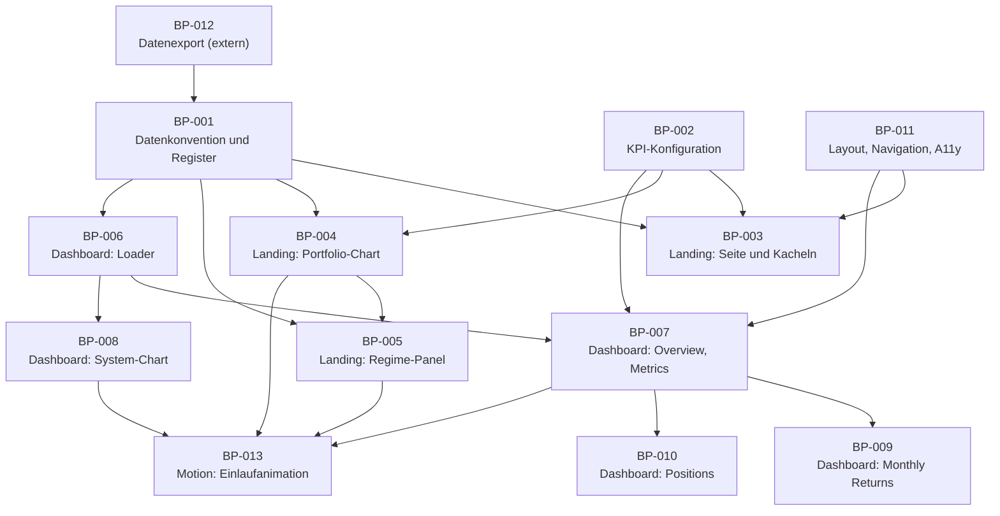

# build_plan.md – Wealth-Lab Meta-Portfolio

| Eigenschaft | Wert |
|---|---|
| Dokumenttyp | SDD – Build-Plan |
| Modus | INIT (Reverse-Dokumentation) |
| Stand | 2026-10-26 |
| Bezug | `project_plan.md` (Anforderungen), `decisions.md` (Entscheidungen), `agents.md` (Arbeitsregeln) |

## 1. Lesehinweise

### 1.1 Charakter dieses Build-Plans

Das Projekt besteht bereits. Dieser Build-Plan ist deshalb **retrospektiv**: Er gliedert den vorhandenen Code in nachvollziehbare Arbeitspakete, damit künftige Aufträge (`PLAN BP-xxx`, `IMPLEMENT BP-xxx`, `VALIDATE BP-xxx`) einen klaren Zuschnitt haben. Die Pakete beschreiben keine neuen Funktionen.

Der Build-Plan darf `project_plan.md` und `decisions.md` nicht fachlich überschreiben. Er darf nicht nachträglich so geändert werden, dass nicht geplante Implementierungen legitimiert werden.

### 1.2 Statuswerte

| Status | Bedeutung |
|---|---|
| **Umgesetzt (Ist)** | Der Code im Repository setzt den Scope um. **Nicht validiert**, weil keine Tests existieren (D-024) und noch keine VALIDATE-Läufe stattfanden. |
| **Extern** | Liegt ausserhalb des Repositorys; nicht prüfbar. |
| **Offen** | Nicht begonnen. Aktuell kein Paket mit diesem Status; Änderungswünsche stehen in Kapitel 4 als Kandidaten ohne Freigabe. |

### 1.3 Definition of Done

Das Projekt definiert keine eigene Definition of Done. Es gilt der SDD-Standard:

1. definierter Scope umgesetzt,
2. keine unbeabsichtigte Funktionserweiterung,
3. betroffene bestehende Funktionen weiterhin konsistent,
4. technische Abhängigkeiten berücksichtigt,
5. relevante Fehlerfälle behandelt, sofern spezifiziert,
6. vorhandene Validierungen erfolgreich (hier: manuelle Prüfliste aus `agents.md`),
7. SDD und Implementierung nicht widersprüchlich,
8. relevante Entscheidungen eingehalten,
9. keine unbegründeten TODOs oder Platzhalter.

---

## 2. Abhängigkeitsübersicht

Die Pfeilrichtung bedeutet "ist Voraussetzung für". Die Reihenfolge entspricht der logischen Baufolge, nicht der Entstehungsgeschichte (nicht rekonstruierbar ohne tiefere Git-Analyse).

---

## 3. Arbeitspakete

### BP-001 – Datenkonvention und Systemregister

| | |
|---|---|
| **Status** | Umgesetzt (Ist), nicht validiert |
| **Ziel** | Einheitliche Ablage der Systemdaten und ein Register, das die Landing-Seite steuert. |
| **Scope** | Ordner `systems/<slug>/` mit vier JSON-Dateien; `js/systems.js` mit `window.SYSTEMS`; Ablauf "Neues System hinzufügen". |
| **Nicht im Scope** | Erzeugung der JSON-Dateien (BP-012); Anzeige-Logik. |
| **Voraussetzungen** | BP-012 liefert die Dateien. |
| **Betroffene Dateien** | `js/systems.js`, `systems/**`, `README.md` |
| **Anforderungen / Decisions** | `project_plan.md` 5.1 bis 5.6, 12.3; D-004, D-005, D-007 |
| **Umsetzungsschritte (Ist)** | 1. Ordner je System. 2. Vier Dateien nach Konvention. 3. Eintrag `{ id, dataPath }`. |
| **Abschlusskriterien** | a) Jedes registrierte System hat alle vier Dateien. b) `id` entspricht dem Ordnernamen und dem Slug-Muster `^[a-z0-9-]+$`. c) `dataPath` zeigt auf den Ordner. d) JSON ist lesbar (NaN toleriert, siehe D-009). |
| **Bekannte Abweichungen** | INC-01, INC-06 (zwei nicht registrierte Ordner), OP-03, OP-04 |

### BP-002 – KPI-Konfiguration und Ampellogik

| | |
|---|---|
| **Status** | Umgesetzt (Ist), nicht validiert |
| **Ziel** | Zentrale Regeln für Farbe, Trophäe und Anzeigeschalter. |
| **Scope** | `WL_KPI_CONFIG` (`colors`, `display`, `metrics`); `getKpiPresentation`. |
| **Voraussetzungen** | keine |
| **Betroffene Dateien** | `js/kpi-config.js` |
| **Anforderungen / Decisions** | `project_plan.md` Kapitel 9; D-015, D-016 |
| **Umsetzungsschritte (Ist)** | Konfigurationsobjekt; Regelauswertung "erste zutreffende Regel"; Abbildung auf Landing- und Dashboard-Klassen. |
| **Abschlusskriterien** | a) Jeder in Landing und Dashboard verwendete `metricKey` hat Regeln und einen Default (Regel ohne `op`). b) Unbekannter Schlüssel oder nicht numerischer Wert ergibt neutral. c) Beide Oberflächen liefern konsistente Klassen. |
| **Bekannte Abweichungen** | INC-10, OP-07, OP-12 |

### BP-003 – Landing-Seite: Seitengerüst und Systemkacheln

| | |
|---|---|
| **Status** | Umgesetzt (Ist), nicht validiert |
| **Ziel** | Einstiegsseite mit Systemübersicht. |
| **Scope** | `index.html` (SEO, Loader, Portfolio-Block, Kachelraster, Footer, Skript-Lader); `landing.js` (Loader, Kacheln, Fehlerkacheln, Tilt); `landing.css`. |
| **Nicht im Scope** | Portfolio-Chart (BP-004), Regime-Panel (BP-005). |
| **Voraussetzungen** | BP-001, BP-002, BP-011 |
| **Betroffene Dateien** | `index.html`, `js/landing.js`, `css/landing.css` |
| **Anforderungen / Decisions** | FR-L-01, FR-L-09 bis FR-L-13; D-007, D-009, D-010, D-020, D-025 |
| **Umsetzungsschritte (Ist)** | Skripte sequenziell laden; `renderSystems` parallel für alle Systeme; Karte oder Fehlerkarte; Tilt ab 701 px. |
| **Abschlusskriterien** | a) Pro registriertem System genau eine Kachel mit Link auf `./dashboard/index.html?system=<id>`. b) Fehlerhafte Daten erzeugen eine Fehlerkachel, andere Kacheln bleiben. c) Leeres Register zeigt Hinweistext. d) Loader verschwindet nach Abschluss. |
| **Bekannte Abweichungen** | INC-04, INC-05, INC-11, INC-18, OP-09 |

### BP-004 – Landing-Seite: Portfolio-Equity-Chart und Portfolio-KPIs

| | |
|---|---|
| **Status** | Umgesetzt (Ist), nicht validiert |
| **Ziel** | Aggregierte Portfolio-Kurve mit Kennzahlen und Interaktion. |
| **Scope** | Laden aller Equity-/Positionsdateien, Normalisierung, Datumsachse, Carry-Forward, Aggregation, laufende Werte, KPI-Karten, SVG, Tooltip, Zoom/Pan/Touch/Reset, Statuszeile. |
| **Nicht im Scope** | Regime-Panel (BP-005). |
| **Voraussetzungen** | BP-001, BP-002 |
| **Betroffene Dateien** | `js/equity-overview-chart.js`, `css/landing.css` (Chart, KPI-Karten) |
| **Anforderungen / Decisions** | FR-L-02 bis FR-L-07; `project_plan.md` 8.1 bis 8.4; D-010, D-011, D-012, D-013, D-014, D-015, D-017 |
| **Umsetzungsschritte (Ist)** | `loadAllSystemEquitySeries` → `buildUnifiedDateAxis` → `aggregatePortfolioSeries` → `renderEquityOverviewChart` → Zoom-Zustand und Events → `calculatePortfolioKpis` → Karten. |
| **Abschlusskriterien** | a) Statuszeile zeigt `<geladen>/<gesamt> systems included`. b) Chart zeigt Equity, Drawdown, Jahreslabels. c) Tooltip zeigt neun Werte. d) Zoom bleibt in den Grenzen der Daten, Mindestspanne 30 Tage. e) Ohne Daten erscheint der Leerzustand statt eines Fehlers. f) KPI-Karten folgen `showPortfolioOverviewKpis` und `useDisplayEquity`. |
| **Bekannte Abweichungen** | INC-08, INC-13, INC-14, OP-06, OP-12 |

### BP-005 – Landing-Seite: Risk-Regime-Panel

| | |
|---|---|
| **Status** | Umgesetzt (Ist), nicht validiert |
| **Ziel** | Marktregime-Verlauf unter dem Portfolio-Chart. |
| **Scope** | Laden und Normalisieren der beiden Regime-Dateien, Zeitraumfilter über `_wlPortfolioTimeRange`, Zustandsbänder, Composite- und Stretch-Linie, End-Label, Tooltip, Legende. |
| **Voraussetzungen** | BP-001; BP-004 (setzt `_wlPortfolioTimeRange`) |
| **Betroffene Dateien** | `js/regime-engine-chart.js`, `js/landing.js` (Aufruf), `index.html` (Panel, Tooltip), `css/landing.css` |
| **Anforderungen / Decisions** | FR-L-08; `project_plan.md` 5.5, 8.7; D-011, D-018 |
| **Abschlusskriterien** | a) Fehlen beide Dateien, erscheint "Regime data unavailable". b) Zustandsbänder entsprechen der Zuordnung in `STATE_COLORS`. c) Stretch-Element folgt `showRegimeStretchScore`. d) Zeitachse entspricht dem Gesamtzeitraum des Portfolio-Charts. |
| **Bekannte Abweichungen** | INC-08, INC-09, INC-17 |

### BP-006 – Dashboard: Loader und URL-Routing

| | |
|---|---|
| **Status** | Umgesetzt (Ist), nicht validiert |
| **Ziel** | System über URL wählen, Daten laden, Renderer starten, Fehler anzeigen. |
| **Scope** | URL-Parameter, Slug-Validierung, paralleles Laden der vier Dateien, NaN-Bereinigung, Mindestanzeigedauer des Loaders, Fehleranzeige in Kopf und Panels. |
| **Voraussetzungen** | BP-001 |
| **Betroffene Dateien** | `js/dashboard-loader.js`, `dashboard/index.html` (Loader-Overlay) |
| **Anforderungen / Decisions** | FR-D-01 bis FR-D-03, FR-D-12; D-006, D-008, D-009, D-010 |
| **Abschlusskriterien** | a) Fehlender oder ungültiger Parameter zeigt die definierte Meldung. b) Fehlende Datei zeigt `Could not load file: <pfad> (<status>)`. c) Erfolgreicher Aufruf ruft `bootDashboard` genau einmal mit dem Payload auf. d) Loader wird in allen Pfaden ausgeblendet. |
| **Bekannte Abweichungen** | INC-07, INC-08, INC-15, INC-16, OP-10 |

### BP-007 – Dashboard: Rendering Overview und Metrics Report

| | |
|---|---|
| **Status** | Umgesetzt (Ist), nicht validiert |
| **Ziel** | Kopfbereich, Tabs, Kennzahlenkarten und -tabellen. |
| **Scope** | `normalizeCurrentState`, Kopf (Titel, Info, Meta), Tabs und Hamburger, Overview-Karten und -Tabelle, Metrics-Tabelle, Karten-Tooltip, `renderError`. |
| **Voraussetzungen** | BP-002, BP-006, BP-011 |
| **Betroffene Dateien** | `js/main.js`, `dashboard/index.html`, `css/styles.css` |
| **Anforderungen / Decisions** | FR-D-04 bis FR-D-07, FR-D-11; `project_plan.md` 5.2, 7.1; D-006, D-007, D-015, D-016, D-021, D-022 |
| **Abschlusskriterien** | a) Neun Karten, 13 Overview-Zeilen, 21 Metrics-Zeilen. b) Fehlende Werte erscheinen als "-". c) Farbe und Trophäe stammen aus `getKpiPresentation`. d) Tab-Wechsel zeigt genau ein Panel. |
| **Bekannte Abweichungen** | INC-10, INC-11, INC-12, INC-19 |

### BP-008 – Dashboard: System-Equity-Chart

| | |
|---|---|
| **Status** | Umgesetzt (Ist), nicht validiert |
| **Ziel** | Equity- und Drawdown-Kurve je System. |
| **Scope** | Normalisierung, Log-Skala, dynamische Drawdown-Achse, Cash-Zonen, Jahreslabels, Tooltip (Maus/Touch), schmales Layout, `ResizeObserver`. |
| **Voraussetzungen** | BP-006, BP-002 (Divisor) |
| **Betroffene Dateien** | `js/equity-system-chart.js` |
| **Anforderungen / Decisions** | FR-D-08; `project_plan.md` 8.6; D-011, D-012, D-015 |
| **Abschlusskriterien** | a) Weniger als zwei Punkte zeigen "Not enough equity data available.". b) Drawdown-Achse deckt den tiefsten Drawdown ab. c) Neuzeichnen bei Breitenänderung ohne Mehrfach-Observer. |
| **Bekannte Abweichungen** | keine eigenen |

### BP-009 – Dashboard: Monthly Returns

| | |
|---|---|
| **Status** | Umgesetzt (Ist), nicht validiert |
| **Ziel** | Monatsrenditen-Matrix mit Jahres- und Durchschnittswerten. |
| **Scope** | `buildMonthlyMatrix`, `calcAnnual`, `renderMonthlyReturns`. |
| **Voraussetzungen** | BP-007 (globale Hilfsfunktionen aus `main.js`) |
| **Betroffene Dateien** | `js/monthly-returns.js`, `css/styles.css` (`.mr-*`) |
| **Anforderungen / Decisions** | FR-D-09; `project_plan.md` 8.5 |
| **Abschlusskriterien** | a) Ohne mindestens zwei Monate erscheint "Not enough equity data for monthly returns.". b) Jahresrendite entspricht der Aufzinsung der Monatswerte. c) Trades pro Monat nur bei `positionCount > 0`. |
| **Bekannte Abweichungen** | keine eigenen; Kopplung an `main.js` beachten (`project_plan.md` 4.4) |

### BP-010 – Dashboard: Positions

| | |
|---|---|
| **Status** | Umgesetzt (Ist), nicht validiert |
| **Ziel** | Positionstabelle mit Sortierung. |
| **Scope** | `renderPositions`, `renderPositionsRows`, Sortierlogik für `entryDate`, `exitDate`, `plPercent`, Days Held, Mobile-Spalten. |
| **Voraussetzungen** | BP-007 |
| **Betroffene Dateien** | `js/main.js`, `dashboard/index.html`, `css/styles.css` |
| **Anforderungen / Decisions** | FR-D-10; `project_plan.md` 7.1 |
| **Abschlusskriterien** | a) Leere Liste zeigt "No positions available.". b) Offene Positionen zeigen "Open" und rechnen Days Held bis heute. c) Wiederholter Klick auf eine Spalte kehrt die Richtung um; Pfeil nur an der aktiven Spalte. d) Preisspalten sind auf Mobile ausgeblendet. |
| **Bekannte Abweichungen** | INC-15 |

### BP-011 – Layout, Navigation und Barrierefreiheit

| | |
|---|---|
| **Status** | Umgesetzt (Ist), nicht validiert |
| **Ziel** | Einheitliche, responsive Darstellung und Bedienbarkeit. |
| **Scope** | Design-Tokens, Kopfbereich, Tabs/Hamburger, Karten, Tabellen, Loader-Overlay, Breakpoints, `prefers-reduced-motion`, ARIA-Attribute. |
| **Voraussetzungen** | keine |
| **Betroffene Dateien** | `css/styles.css`, `css/landing.css`, `index.html`, `dashboard/index.html` |
| **Anforderungen / Decisions** | `project_plan.md` 10.1 bis 10.4; D-019, D-020, D-021 |
| **Abschlusskriterien** | a) Darstellung unterhalb und oberhalb der Breakpoints 700 px, 768 px und 1280 px ohne horizontales Überlaufen der Hauptbereiche. b) Alle interaktiven Elemente des Dashboards sind per Tastatur erreichbar, soweit im Ist vorgesehen. c) Animationen entfallen bei `prefers-reduced-motion`. |
| **Bekannte Abweichungen** | D-021 (Landing-Tooltips nur per Hover), D-019 (doppelte `:root`-Blöcke) |

### BP-012 – Datenexport aus Wealth-Lab nach `systems/**`

| | |
|---|---|
| **Status** | Extern, nicht prüfbar |
| **Ziel** | Erzeugung und Veröffentlichung der JSON-Dateien. |
| **Scope** | Export von `wl-*.json`, Regime-Dateien, automatischer Commit `Auto update trading dashboard <Zeitstempel>`. |
| **Hinweis** | Nicht Teil dieses Repositorys. Das Paket steht hier nur, damit die Abhängigkeit sichtbar ist. Schnittstelle zum Repository ist ausschliesslich das Datenformat aus `project_plan.md` Kapitel 5. |
| **Abschlusskriterien** | nicht definierbar ohne Information (OP-01) |

### BP-013 – Motion: Einlaufanimation von Charts und Kennzahlen

| | |
|---|---|
| **Status** | Umgesetzt (2026-10-26) und im Browser geprüft (Chrome headless, Echtzeit, siehe "Prüfung"); nicht geprüft in anderen Browsern und auf echten Mobilgeräten |
| **Ziel** | Charts zeichnen sich beim Öffnen ein, Kennzahlen zählen hoch (Vorschlag 1 "Daten zum Leben erwecken"). |
| **Scope** | Neue Dateien `css/motion.css` und `js/motion.js` (`WL_MOTION`); Markup-Ergänzungen im Portfolio-Chart, Regime-Panel, System-Chart; Hochzählen in `createKpiCard` (Landing) und `renderOverview` (Dashboard); Einbindung in `index.html` (Skriptliste, Stylesheet) und `dashboard/index.html`. |
| **Nicht im Scope** | Vorschläge 2 und 3; Änderung von Berechnungen, Formaten, KPI-Regeln, Loader-Vertrag; globale Reduced-Motion-Regel für `landing.css` (INC-20). |
| **Voraussetzungen** | BP-004, BP-005, BP-007, BP-008 (betroffene Render-Funktionen) |
| **Betroffene Dateien** | `css/motion.css` (neu), `js/motion.js` (neu), `js/equity-overview-chart.js`, `js/regime-engine-chart.js`, `js/equity-system-chart.js`, `js/main.js`, `index.html`, `dashboard/index.html` |
| **Anforderungen / Decisions** | FR-M-01 bis FR-M-07; D-026; D-001, D-011, D-019, D-025 |
| **Umsetzungsschritte** | 1. `motion.js`: `wl-motion`-Klasse (nicht bei Reduced-Motion), Bereitschaft über `#pageLoader` (`hidden`, Fallback 8 s), `countUp`. 2. `motion.css`: Keyframes und Klassen `wl-draw-line`, `wl-fade-in`, `wl-trophy-pop`. 3. Markup der drei Charts ergänzen, nur beim Erstrendern. 4. Hochzählen und Trophäen-Pop in den Kennzahlenkarten. 5. Einbindung in beide HTML-Seiten. |
| **Abschlusskriterien** | a) Erstaufruf: Linie zeichnet sich nach dem Loader ein, KPIs zählen hoch, Endwerte identisch zu vorher. b) Zoom, Pan, Reset und Resize lösen keine neue Einzeichnung aus. c) System-Chart zeichnet sich beim ersten Öffnen des Tabs ein. d) Bei `prefers-reduced-motion: reduce` und ohne `motion.js` erscheint der Endzustand sofort. e) Fehlende Daten verhalten sich wie bisher (Fehlerkachel, Leerzustand). f) Konsole ohne neue Fehler. |
| **Bekannte Abweichungen** | INC-20 (nicht Teil des Pakets) |
| **Prüfung (2026-10-26)** | **Erfüllt** (Chrome headless über DevTools-Protokoll, Echtzeit, Server lokal): a) Loader ausgeblendet nach ca. 0,7 s, danach Einzeichnung (Offset 1 → 0 in ca. 1,4 s) und Hochzählen; Endwerte Landing `41.75% / 3192% / -13.79% / 2.29 / 2.33 / 65.65%` und Dashboard `45.32% / 4120% / -33.47% / 25.90 / 1.29 / 1.35 / 44.30 / 66.67% / 4` sind identisch mit dem Lauf bei `prefers-reduced-motion`. b) Mausrad-Zoom auf dem Portfolio-Chart erzeugt die Linie ohne Motion-Klasse; Fenstergrösse 900 px und 390 px zeichnet den System-Chart ohne Motion-Klasse neu. c) System-Chart animiert beim ersten Öffnen des Tabs (Offset 0,99 → 0 in ca. 1,5 s). d) Mit `--force-prefers-reduced-motion` setzt `motion.js` keine Klassen, Endwerte erscheinen sofort. f) Keine Konsolenfehler. **Nicht prüfbar / offen:** e) Fehlerfälle (fehlende Daten) nicht gezielt provoziert; Firefox, Safari und echte Touch-Geräte nicht getestet; Touch-Zoom nicht getestet. |

---

## 4. Änderungskandidaten (nicht freigegeben)

Die folgenden Punkte ergeben sich aus den Inkonsistenzen und offenen Fragen in `project_plan.md` Kapitel 14. Sie sind **keine Arbeitspakete** und haben bewusst keine BP-ID. Ohne ausdrückliche Entscheidung des Auftraggebers werden sie nicht umgesetzt. Der Weg dazu: Entscheidung treffen → `CHANGE` → neues Arbeitspaket → `IMPLEMENT`.

| Kandidat | Bezug | Entscheidung erforderlich |
|---|---|---|
| C-01 | README an Ist-Stand anpassen (zehn Systeme, Dateiliste, Beispiel-URL) | INC-01 bis INC-03: ja/nein |
| C-02 | Systembeschreibung "9 systems" und Footerjahr vereinheitlichen | INC-04, INC-05: ja/nein, gewünschter Wortlaut |
| C-03 | Zwei nicht registrierte Systeme behandeln | OP-03: registrieren, aktualisieren oder entfernen |
| C-04 | Anzeige oder Entfall der Signale | OP-05 |
| C-05 | Dashboard auf registrierte Systeme beschränken | OP-10 |
| C-06 | `NaN`-Bereinigung in allen Ladepfaden | INC-08: ja/nein |
| C-07 | Regime-Panel bei Zoom synchronisieren, Loader-Abwarten | INC-09: ja/nein |
| C-08 | Verlaufsdefinition des Max-DD-Overlays klären oder Overlay entfernen | INC-13 |
| C-09 | Drawdown-Achse des Portfolio-Charts dynamisch statt fest | INC-14 |
| C-10 | Gemeinsame Hilfsfunktionen statt Duplikate | INC-19: ja/nein; würde D-001 nicht verletzen, ist aber Refactoring |
| C-11 | Angaben zur Berechnungsvariante, Skalierung und Ampelschwellen dokumentieren | OP-06, OP-07, OP-12 (reine Dokumentation) |

---

## 5. Traceability-Matrix

| Anforderung | BP | Decision |
|---|---|---|
| FR-L-01 | BP-003 | D-025 |
| FR-L-02 bis FR-L-07 | BP-004 | D-011 bis D-017 |
| FR-L-08 | BP-005 | D-018 |
| FR-L-09 bis FR-L-13 | BP-003 | D-005, D-007, D-020 |
| FR-D-01 bis FR-D-03 | BP-006 | D-006, D-008, D-009, D-010 |
| FR-D-04 bis FR-D-07, FR-D-11 | BP-007 | D-006, D-016, D-021 |
| FR-D-08 | BP-008 | D-011, D-012 |
| FR-D-09 | BP-009 | – |
| FR-D-10 | BP-010 | – |
| FR-D-12 | BP-006, BP-007 | D-006 |
| FR-M-01 bis FR-M-07 | BP-013 | D-026 |
| Q-01 | alle | D-001 |
