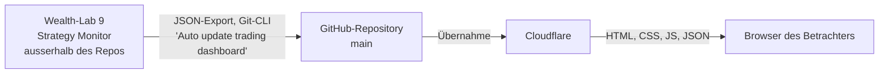
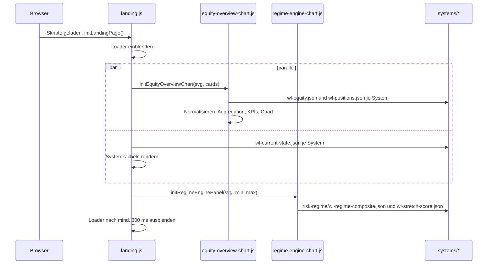
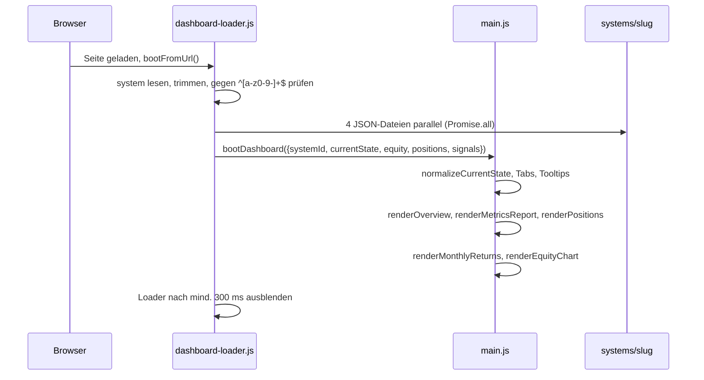

# project_plan.md – Wealth-Lab Meta-Portfolio (Strategy Orchestrator)

| Eigenschaft | Wert |
|---|---|
| Dokumenttyp | SDD – Projektplan (Soll-/Ist-Beschreibung) |
| Modus | INIT (Reverse-Dokumentation eines bestehenden Projekts) |
| Stand | 2026-10-27 |
| Repository | `Wealth-Lab-Strategy-Orchestrator` (Remote: `github-ascnet/WL-Trading-Systems-Overview`) |
| Branch / letzter Commit | `main` / `bdc3124` ("Update Regime-Filter") |
| Begleitdokumente | `decisions.md`, `build_plan.md`, `agents.md` |

---

## 0. Methodik und Lesehinweise

### 0.1 Quellenbasis

Dieses Dokument wurde ausschliesslich aus dem vorhandenen Repository abgeleitet. Es wurden gelesen:

- `README.md`, `index.html`, `dashboard/index.html`
- `css/styles.css`, `css/landing.css`
- alle zehn Dateien unter `js/`
- alle JSON-Dateien unter `systems/` (Struktur und Kennzahlen per Skript geprüft)
- die Git-Historie (Commit-Muster, Remote)

Es existiert kein früherer Projektplan und keine ausdrückliche Anforderungsliste ausser der `README.md`. Alle Anforderungen unten sind deshalb **Ist-Anforderungen**: Sie beschreiben, was die Lösung nachweislich tut oder was die README ausdrücklich festhält. Neue Anforderungen wurden nicht erfunden.

### 0.2 Herkunftskennzeichnung

Jede Aussage trägt, wo relevant, eine Herkunft:

| Kürzel | Bedeutung |
|---|---|
| **[README]** | Ausdrücklich in `README.md` festgehalten |
| **[CODE]** | Aus dem Quellcode ersichtlich (Ist-Zustand, nicht automatisch Soll) |
| **[DATEN]** | Aus den Dateien unter `systems/` ersichtlich |
| **[GIT]** | Aus der Git-Historie ersichtlich |
| **[OFFEN]** | Nicht belegbar, Entscheidung oder Information erforderlich (siehe Kapitel 14) |

Gemäss SDD-Regel gilt: Der Code ist der Ist-Zustand, aber nicht automatisch die fachliche Wahrheit. Aussagen mit Herkunft **[CODE]** sind in `decisions.md` mit dem Status "Ist-Zustand, Bestätigung ausstehend" geführt, sofern sie eine Entscheidung darstellen.

---

## 1. Zweck und Ziel

### 1.1 Zweck

Die Lösung ist eine **statische, rein clientseitige Multi-System-Dashboard-Anwendung** für ein systematisches Handelsportfolio, das in Wealth-Lab entwickelt und getestet wird. [README] [CODE]

Sie stellt dar:

1. eine **Portfolio-Übersicht** (Landing-Seite) mit aggregierter Equity-Kurve, Portfolio-Kennzahlen, Risk-Regime-Verlauf und einer Kachel je Handelssystem,
2. ein **gemeinsames Detail-Dashboard** je Handelssystem (Overview, Equity Curve, Metrics Report, Monthly Returns, Positions).

### 1.2 Fachlicher Kontext (aus der Landing-Seite)

Der Info-Text der Landing-Seite beschreibt das Portfolio als mehrstrategisches, regimebewusstes, regelbasiertes System, das 2016 mit zwei Strategien startete und seit 2019 schrittweise erweitert wurde. [CODE – `index.html`, Tooltip "Portfolio history"]

Das Dokument übernimmt diese Beschreibung nicht als Anforderung, sondern nur als Kontext.

### 1.3 Zielgruppe der Anwendung

Aus den SEO-Metadaten (`robots: index, follow`, `canonical`, Open Graph, JSON-LD) geht hervor, dass die Landing-Seite öffentlich auffindbar sein soll. [CODE – `index.html`] Hauptnutzer ist der Auftraggeber selbst: Die Seite dient vor allem dazu, die einzelnen Systeme unterwegs auf dem Handy kurz anzuschauen. [AUFTRAGGEBER 2026-10-27, beantwortet OP-09] Mobile Bedienbarkeit hat deshalb Gewicht.

---

## 2. Scope und Nicht-Scope

### 2.1 Im Scope (Ist)

| ID | Bereich |
|---|---|
| S-01 | Darstellung der Landing-Seite (Portfolio-Übersicht, Systemkacheln) |
| S-02 | Darstellung des Dashboards je System über URL-Parameter |
| S-03 | Laden der vier System-JSON-Dateien und der zwei Regime-JSON-Dateien per `fetch` |
| S-04 | Clientseitige Berechnung von Portfolio-Kennzahlen aus den Equity- und Positionsdaten |
| S-05 | Zentrale, regelbasierte Farb- und Trophäenlogik für Kennzahlen |
| S-06 | Responsive Darstellung (Desktop, Tablet, Mobile) im Dark Theme |

### 2.2 Nicht im Scope (belegt)

| ID | Ausschluss | Herkunft |
|---|---|---|
| NS-01 | Build-Tools, Frameworks, npm-Abhängigkeiten | [README] |
| NS-02 | Projektindividuelles `config.json` | [README] |
| NS-03 | Root-Ordner `data/` | [README] |
| NS-04 | Backend, API, Datenbank, Authentifizierung (nicht vorhanden) | [CODE] |
| NS-05 | Erzeugung der JSON-Daten (erfolgt ausserhalb des Repositorys, siehe 12.2) | [GIT] [OFFEN] |
| NS-06 | Anzeige der Signale aus `wl-signals.json` (Datei wird geladen, aber nicht dargestellt, siehe INC-12) | [CODE] |
| NS-07 | Automatisierte Tests, CI/CD (im Repository nicht vorhanden) | [CODE] |

---

## 3. Systemkontext



Wealth-Lab 9 exportiert die Systemdaten über den Strategy Monitor; die Git-CLI lädt sie nach GitHub hoch, von dort übernimmt Cloudflare den Stand. Exportmechanismus und Hosting sind nicht Teil des Repositorys. [AUFTRAGGEBER 2026-10-27, beantwortet OP-01, OP-02]

---

## 4. Architektur

### 4.1 Architekturprinzipien (verbindlich laut README)

- Zwei Einstiegsseiten, gemeinsamer HTML/CSS/JS-Code. [README]
- Dashboard-Datenquelle ist `systems/<slug>/`. [README]
- Datenladen und Rendering sind getrennt: `js/dashboard-loader.js` lädt, `js/main.js` rendert über `bootDashboard(...)`. [README]
- Reines HTML/CSS/Vanilla-JavaScript. [README]

### 4.2 Dateistruktur (Ist)

```text
Wealth-Lab-Strategy-Orchestrator/
|- index.html                      Landing-Seite
|- dashboard/
|  |- index.html                   Gemeinsames System-Dashboard
|- css/
|  |- landing.css                  Styles der Landing-Seite
|  |- styles.css                   Styles des Dashboards
|  |- motion.css                   Einlaufanimationen (beide Seiten)
|- js/
|  |- systems.js                   Systemregister (window.SYSTEMS)
|  |- kpi-config.js                KPI-Konfiguration und Ampellogik
|  |- motion.js                    Motion: Bereitschaft, Hochzählen (beide Seiten)
|  |- landing.js                   Landing: Karten, Orchestrierung
|  |- equity-overview-chart.js     Landing: Portfolio-Chart und -KPIs
|  |- regime-engine-chart.js       Landing: Risk-Regime-Panel
|  |- dashboard-loader.js          Dashboard: URL, Laden, Fehlerbehandlung
|  |- main.js                      Dashboard: Rendering (bootDashboard)
|  |- monthly-returns.js           Dashboard: Monatsrenditen
|  |- equity-system-chart.js       Dashboard: System-Equity-Chart
|- systems/
|  |- <slug>/                      je System 4 JSON-Dateien
|  |- risk-regime/                 2 JSON-Dateien (Regime, kein System)
|- docs/sdd/                       SDD-Dokumentation (dieses Verzeichnis)
|- README.md
```

### 4.3 Komponenten und Verantwortlichkeiten

| Komponente | Datei | Verantwortung | Globale Schnittstelle |
|---|---|---|---|
| Systemregister | `js/systems.js` | Liste der auf der Landing-Seite angezeigten Systeme (`id`, `dataPath`) | `window.SYSTEMS` |
| KPI-Konfiguration | `js/kpi-config.js` | Farben, Anzeige-Schalter, Regeln je Kennzahl, Auswertung `getKpiPresentation` | `window.WL_KPI_CONFIG`, `window.getKpiPresentation` |
| Landing-Orchestrierung | `js/landing.js` | Loader, Systemkacheln, Tilt-Effekt, Start von Portfolio-Chart und Regime-Panel | keine (IIFE) |
| Portfolio-Chart | `js/equity-overview-chart.js` | Laden aller Equity-/Positionsdaten, Aggregation, KPIs, SVG, Zoom/Pan | `window.initEquityOverviewChart`, `window._wlPortfolioTimeRange` |
| Regime-Panel | `js/regime-engine-chart.js` | Laden und Zeichnen von Composite- und Stretch-Score | `window.initRegimeEnginePanel`, `window.renderRegimeEnginePanel` |
| Motion | `js/motion.js`, `css/motion.css` | Aktivierung der Einlaufanimationen (nicht bei Reduced-Motion), Start nach dem Loader, Hochzählen von Kennzahlen, Regime-Tint, Tab-Indikator | `window.WL_MOTION` (`countUp`, `whenReady`, `setRegime`, `initTabIndicator`) |
| Dashboard-Loader | `js/dashboard-loader.js` | URL-Parameter lesen, validieren, 4 JSON-Dateien laden, `bootDashboard` aufrufen, Fehler anzeigen | keine (IIFE, startet sofort) |
| Dashboard-Renderer | `js/main.js` | Normalisierung, Tabs, Overview, Metrics, Positions, Tooltips | `window.bootDashboard`, `window.renderError` sowie globale Funktionen (`escapeHtml`, `formatNumber`, `formatPercent`, `getValueClass` u. a.) |
| Monatsrenditen | `js/monthly-returns.js` | Monatsmatrix, Jahresrendite, Tabelle | globale Funktion `renderMonthlyReturns` |
| System-Chart | `js/equity-system-chart.js` | SVG-Equity-/Drawdown-Chart, Resize-Verhalten | `window.renderSystemEquityChart`, `window.mountSystemEquityChart` |

### 4.4 Skript-Ladereihenfolge

| Seite | Mechanismus | Reihenfolge |
|---|---|---|
| Landing | Dynamisches, **sequenzielles** Nachladen mit Cache-Buster `?v=<Date.now()>` [CODE] | `systems.js` → `kpi-config.js` → `motion.js` → `equity-overview-chart.js` → `regime-engine-chart.js` → `landing.js` |
| Dashboard | Dynamisches, **sequenzielles** Nachladen ohne Cache-Buster (seit D-029; zuvor statische `<script>`-Tags) | `systems.js` (seit D-037) → `monthly-returns.js` → `kpi-config.js` → `motion.js` → `equity-system-chart.js` → `main.js` → `dashboard-loader.js` |

Kopplung: `monthly-returns.js` ruft Funktionen auf, die erst in `main.js` definiert werden (`escapeHtml`, `formatNumber`, `formatPercent`, `getValueClass`). Das funktioniert, weil die Aufrufe zur Laufzeit nach dem Laden aller Skripte erfolgen. [CODE]

### 4.5 Ablauf Landing-Seite



### 4.6 Ablauf Dashboard



Ein Fehler in einer der vier Dateien bricht das gesamte Laden ab (`Promise.all`). [CODE]

---

## 5. Datenmodell

### 5.1 Dateikonvention je System **[README]**

Pro System genau diese vier Dateien unter `systems/<slug>/`:

| Datei | Inhalt | Struktur |
|---|---|---|
| `wl-current-state.json` | Kennzahlen und Metadaten | ein Objekt |
| `wl-equity.json` | Equity-Zeitreihe | Array von `{date, equity}` |
| `wl-positions.json` | Positionen | Array von Positionsobjekten |
| `wl-signals.json` | Signale | Array (zwei Varianten, siehe 5.4) |

Die JSON-Dateien beginnen mit einem UTF-8-BOM. [DATEN] Der Browser entfernt es beim Dekodieren; im Code ist dafür keine Behandlung vorhanden. [CODE]

### 5.2 `wl-current-state.json`

Alle 12 vorhandenen Dateien enthalten dieselben 29 Felder. [DATEN]

| Feld | Typ | Verwendung im Code |
|---|---|---|
| `strategyName` | string | Titel, Kachel (Alias `name`) |
| `strategyDescription` | string | Info-Tooltip, Kachelbeschreibung, Meta-Description (Alias `description`) |
| `symbolUniverse` | string `"<Universe>;<Datasource>"` | Kachel zeigt den Rohwert; Dashboard splittet an `;` in Universe und Datasource (Alias `universeName`) |
| `benchmark` | string | Overview-Tabelle |
| `mode` | string (z. B. "Long Only") | **nicht verwendet** |
| `lastUpdate` | string `"YYYY-MM-DD HH:mm:ss"` | Kachel, Badge "Updated" (Aliase `lastUpdated`, `generatedAt`, `updatedAt`) |
| `startingCapital` | number | Overview/Metrics (geteilt durch `startingCapitalDivisor`) |
| `backtestStartDate` | string `YYYY-MM-DD` | Overview/Metrics |
| `apr` | number (%) | Kachel, Card, Metrics (Aliase `cagr`, `totalReturnCagr`) |
| `profit` | number | im Code normalisiert, **nicht angezeigt** |
| `profitPercent` | number (%) | Kachel, Card, Tabellen |
| `riskReturnMetaScore` | number 0–100 | Card, Metrics |
| `sharpeRatio` | number | Kachel, Card, Metrics |
| `marRatio` | number | Card, Metrics |
| `recoveryFactor` | number | Overview, Metrics |
| `maxDrawdown` | number (% negativ) | Kachel, Card, Metrics (Aliase `maxDd`, `drawdown`) |
| `avgReturnYear` | number (%) | Overview, Metrics |
| `stdDeviationYear` | number | Overview, Metrics |
| `avgBarsHeld` | number | Metrics |
| `exposure`, `maximumExposure` | number (%) | Overview, Metrics |
| `profitFactor` | number | Card, Metrics |
| `avgProfitPercent` | number (%) | Overview, Metrics |
| `profitablePercent` | number (%) | Kachel, Card, Metrics |
| `positionCount` | number | Overview, Durchschnitt Trades pro Monat |
| `nsfPositionCount` | number | Metrics |
| `maxMarginUsed` | number | Metrics |
| `avgEntryEfficiencyPercent`, `avgExitEfficiencyPercent` | number (%) | Metrics |

Fehlt ein Feld, wird "-" angezeigt (`formatNumber`/`formatPercent`). Optionale Felder `openPositions`/`positionsCount` und `signalCount`/`signalsCount` werden bei Fehlen aus den Arrays abgeleitet. [README] [CODE]

### 5.3 `wl-equity.json` und `wl-positions.json`

**Equity:** `{ "date": "YYYY-MM-DD", "equity": <number> }`. Die Abtastung ist je System unterschiedlich: täglich bei den meisten Systemen (ca. 2 518 Punkte), wöchentlich bei `btc-gold-regime-breakout` (522 Punkte). [DATEN]

**Positionen:** `{ symbol, entryDate, exitDate, entryPrice, exitPrice, qty, pl, plPercent, isOpen }`. Offene Positionen haben `exitDate: null`, `exitPrice: null`, `isOpen: true`. [DATEN]

Als "offen" gilt eine Position im Code, wenn `isOpen === true` **oder** `exitDate` leer/`null`/`"open"` ist. [CODE]

### 5.4 `wl-signals.json`

Zwei Varianten kommen vor [DATEN]:

- **Leermeldung:** `{ "message": "No signals generated for the latest backtest run", "timestamp": "…" }` (10 von 12 Systemen)
- **Signaldatensatz:** `{ symbol, action, isEntry, signalDate, entryPrice, stopPrice, targetPrice, positionSizePercent, signalName, orderType, signalStatus, weight }` (`adaptive-knife-juggler`: 4, `capitulation-bounce`: 4, `monday-anchor-reversion-500k-cap`: 1)

Die Datei wird vom Dashboard geladen, aber nicht angezeigt; sie fliesst nur über `signalCount` in das normalisierte Objekt ein, das selbst nicht gerendert wird. [CODE] (INC-12)

### 5.5 Regime-Daten (`systems/risk-regime/`)

| Datei | Zeitraum | Punkte | Zustände |
|---|---|---|---|
| `wl-regime-composite.json` | 2017-03-24 bis 2026-10-22 | 2 409 | `StrongRiskOn`, `RiskOn`, `Neutral`, `Caution`, `RiskOff` |
| `wl-stretch-score.json` | 2016-12-28 bis 2026-10-22 | 2 468 | `ExtremeDown`, `Down`, `Up`, `ExtremeUp` |

Struktur: `{ date, value (0–100), state }`. [DATEN] Dieser Ordner ist kein Handelssystem und steht bewusst nicht in `systems.js`. [CODE]

### 5.6 Systemregister `js/systems.js`

`window.SYSTEMS` ist ein Array von `{ id, dataPath }`. `dataPath` ist relativ zur Landing-Seite (`./systems/<slug>`). Fehlt `dataPath`, wird `./systems/<id>` verwendet. [CODE] Das Dashboard verwendet `dataPath` **nicht**, sondern fest `../systems/<slug>`. [CODE]

---

## 6. Funktionale Beschreibung – Landing-Seite (`index.html`)

| ID | Anforderung (Ist) | Herkunft |
|---|---|---|
| FR-L-01 | Beim Laden wird ein Overlay "Loading dashboard…" gezeigt und nach Abschluss, frühestens nach 300 ms, ausgeblendet. | [CODE] |
| FR-L-02 | Die Seite zeigt einen Portfolio-Block mit Titel "Wealth-Lab Portfolio", Statusanzeige (`"<geladen>/<gesamt> systems included"`), Equity-Chart und KPI-Karten. | [CODE] |
| FR-L-03 | Ein Info-Symbol "!" zeigt per Hover die Portfolio-Historie als Tooltip (auf Mobile unterhalb des Titels über die volle Breite). | [CODE] |
| FR-L-04 | Das Portfolio wird aus **allen** in `SYSTEMS` registrierten Systemen aggregiert. Fehlschlagende Systeme werden übersprungen und per `console.warn` gemeldet. | [CODE] |
| FR-L-05 | Der Chart zeigt Equity (log-Skala, linke Achse), Drawdown (rechte Achse, orange; 0 bis −30 % in 5-%-Schritten, bei tieferem Drawdown bis zum nächsten 10-%-Raster in 10-%-Schritten, D-042) und Jahreslabels. | [CODE] |
| FR-L-06 | Der Chart unterstützt Zoom (Mausrad), Pan (Ziehen), Reset (Doppelklick, Reset-Button), Touch (Pinch, Wischen) und einen Crosshair-Tooltip mit neun Werten. | [CODE] |
| FR-L-07 | Sechs KPI-Karten: APR/CAGR, Profit %, Max Drawdown, Profit Factor, Sharpe Ratio, Profitable %. Die Karten können über `showPortfolioOverviewKpis` ausgeblendet werden. | [CODE] |
| FR-L-08 | Ein Risk-Regime-Panel zeigt den Composite Score (0–100) mit Zustands-Hintergrund und optional den Stretch Score. Die X-Achse folgt dem Zeitraum des Portfolio-Charts. | [CODE] |
| FR-L-09 | Pro registriertem System wird eine Kachel gerendert, die auf `./dashboard/index.html?system=<id>` verlinkt. Kachelinhalt siehe 6.1. | [CODE] [README] |
| FR-L-10 | Schlägt das Laden einer Kachel fehl, erscheint eine Fehlerkachel "Data currently unavailable…"; andere Kacheln bleiben unberührt. | [CODE] |
| FR-L-11 | Ist `SYSTEMS` leer, erscheint "No systems defined in js/systems.js.". | [CODE] |
| FR-L-12 | Auf Viewports ab 701 px reagieren die Kacheln mit 3D-Tilt und Glanzeffekt; Fehlerkacheln ausgenommen. | [CODE] |
| FR-L-13 | Die Landing-Seite enthält SEO-Metadaten (title, description, robots, canonical, Open Graph, JSON-LD `WebSite`). | [CODE] |
| FR-L-14 | Das Risk-Regime-Panel (FR-L-08) ist über `display.showRiskRegimePanel` in `kpi-config.js` ein- oder ausblendbar, Standard ausgeblendet. Ausgeblendet wird es nicht gerendert; die Regime-Färbung des Hintergrunds bleibt (D-034, BP-022). | Auftrag 2026-10-26 |

### 6.1 Systemkachel

Anzeige: Name (`strategyName`, unverändert), Beschreibung (falls vorhanden), Sparkline der Equity-Kurve (seit BP-015, FR-M-15), und die Zeilen Universe, APR/CAGR, Profit % (0 Dezimalstellen), Profitable %, Sharpe Ratio, Max Drawdown, Last Updated (`dd/mm/yyyy, hh:mm`, en-GB).

Farbregeln: APR, Profitable %, Sharpe, Max Drawdown werden über `getKpiPresentation(..., "landing")` eingefärbt. Trophäen sind seit 2026-10-27 über `display.showTrophies: false` abgeschaltet (D-041); zuvor bei Profitable % und Sharpe, nicht bei APR (INC-10).

---

## 7. Funktionale Beschreibung – Dashboard (`dashboard/index.html`)

| ID | Anforderung (Ist) | Herkunft |
|---|---|---|
| FR-D-01 | System über URL-Parameter `?system=<slug>`. Fehlt der Parameter oder verletzt er `^[a-z0-9-]+$`, wird eine Fehlermeldung angezeigt. | [README] [CODE] |
| FR-D-02 | Parallel werden die vier JSON-Dateien geladen (`fetch`, `cache: "no-store"`). | [README] [CODE] |
| FR-D-03 | Bare `NaN`-Werte in JSON werden zu `null` ersetzt und erneut geparst; sonst Fehlermeldung "Data file is invalid or contains unsupported values.". | [CODE] |
| FR-D-04 | Kopfbereich: Strategiename (Klammerzusätze entfernt), Info-Symbol mit der vollständigen Beschreibung, Link "Dashboard" zurück zu `../index.html`. Dokumenttitel und Meta-Description werden gesetzt. | [CODE] |
| FR-D-05 | Fünf Tabs: Overview, Equity Curve, Metrics Report, Monthly Returns, Positions. Auf Mobile als Hamburger-Menü mit Anzeige des aktiven Tab-Namens. | [CODE] |
| FR-D-06 | **Overview:** Badge "Updated: <Datum>", neun KPI-Karten (APR, Profit %, Max Drawdown, Profit Factor, Sharpe Ratio, MAR Ratio, Risk-Return Score mit Tooltip, Profitable %, Open Trades) und 13-zeilige KPI-Tabelle. | [CODE] |
| FR-D-07 | **Metrics Report:** 21-zeilige KPI-Tabelle (siehe 5.2). | [CODE] |
| FR-D-08 | **Equity Curve:** SVG-Chart mit Equity (log), Drawdown (rechte, dynamische Achse), Cash-Zonen und Crosshair-Tooltip (Datum, Portfolio, Profit, Max Drawdown). | [CODE] |
| FR-D-09 | **Monthly Returns:** Matrix Jahr × Monat plus Jahresrendite, Durchschnitt der Monatsrendite und durchschnittliche Trades pro Monat. | [CODE] |
| FR-D-10 | **Positions:** Tabelle mit Symbol, Entry Date, Exit Date, Entry Price, Exit Price, P/L %, Days Held. Sortierbar nach Entry Date, Exit Date, P/L %. Offene Positionen zeigen "Open". | [CODE] |
| FR-D-11 | Kartenbeschriftungen mit `data-tooltip` zeigen einen eigenen Tooltip (Hover und Fokus). | [CODE] |
| FR-D-12 | Fehler beim Laden oder Rendern werden im Kopfbereich und in jedem Panel angezeigt. | [CODE] |

### 7.1 Berechnete Anzeigewerte im Dashboard

- **Symbol:** Suffix ab dem ersten Punkt wird entfernt (`NVDA.US` → `NVDA`).
- **Days Held:** `round((exitDate − entryDate) / 86 400 000)`. Bei offenen Positionen gegen `Date.now()`.
- **Starting Capital:** `startingCapital / startingCapitalDivisor`.
- **Sortierung:** `exitDate` leer wird als `Infinity` behandelt (offene Positionen am Ende bei aufsteigender Sortierung), `entryDate` leer als 0.
- **Open Trades:** Karte grün bei > 0, rot bei 0.

---

## 8. Berechnungslogik

### 8.1 Portfolio-Aggregation (Landing)

Quelle: `js/equity-overview-chart.js`. [CODE]

1. **Normalisierung** je System: Datum auf ISO-Tagesdatum, ungültige Punkte verwerfen (mit Warnung), je Datum gewinnt der letzte Eintrag, aufsteigend sortiert.
2. **Einheitliche Datumsachse:** Vereinigung aller Datumswerte aller Systeme.
3. **Carry-Forward:** fehlende Werte erhalten den letzten bekannten Wert; **vor** dem ersten Datum eines Systems wird dessen erster Equity-Wert verwendet.
4. **Portfolio-Equity** `equity` = Summe der aufgefüllten Equity-Werte aller Systeme (Rohsumme in Dollar-Basis).
5. **`displayEquity`:** Startwert = Summe am ersten Tag; je Folgetag multipliziert mit `1 + Mittelwert der Tagesrenditen der Systeme` (Equal-Weight). Wird nur verwendet, wenn `useDisplayEquity === true` (derzeit `false`).
6. Punkte ohne aktives System werden verworfen.

### 8.2 Laufende Werte im Tooltip

| Wert | Berechnung |
|---|---|
| Open Positions | Summe über Systeme der Positionen mit `entryDate ≤ D` und (`isOpen` oder kein Exit oder `exitDate > D`) |
| Profit Factor | kumulierter Bruttogewinn / kumulierter Bruttoverlust der bis D geschlossenen Positionen (`pl`); `null`, wenn eine Seite 0 ist |
| Profitable % | kumulierte Anzahl Gewinn-Positionen / kumulierte Anzahl geschlossener Positionen |
| Sharpe Ratio | laufendes CAGR / annualisierte Volatilität (online berechnet, mindestens 2 Renditen) |
| APR/CAGR | `(equity / startEquity)^(365,25 / Tage) − 1`, nur bei > 1 Tag |
| Profit | `(equity − startEquity) / startEquity` |
| Drawdown | `(equity − Peak) / Peak` |

Die Startwerte für APR und Profit beziehen sich auf den Beginn des **gesamten** Zeitraums, auch bei gezoomter Ansicht. [CODE]

### 8.3 Portfolio-KPIs (Karten)

| KPI | Formel |
|---|---|
| APR/CAGR | `(endEquity / startEquity)^(365,25 / Tage) − 1` |
| Profit % | `(end − start) / start` |
| Max Drawdown | grösster negativer Abstand zum laufenden Höchststand |
| Sharpe Ratio | `CAGR% / (σ(Schrittrenditen) · √Perioden pro Jahr · 100)`, Perioden pro Jahr = `Anzahl Renditen / (Tage / 365,25)`; kein risikofreier Zins |
| Profit Factor | Σ Bruttogewinn / Σ Bruttoverlust aller geschlossenen Positionen aller Systeme; Fallback auf Summe positiver/negativer Schrittrenditen |
| Profitable % | Anteil geschlossener Gewinn-Positionen; Fallback auf Anteil positiver Schrittrenditen |

Alle KPIs rechnen auf der Rohsumme, solange `useDisplayEquity` `false` ist. [CODE] Verbindlich ist die Rohsumme; die Gewichtung der Systeme legt der Auftraggeber in Wealth-Lab 9 fest. [AUFTRAGGEBER 2026-10-27, beantwortet OP-12]

### 8.4 Anzeige-Skalierung

Equity-Beträge im Chart (Achsenbeschriftung, Tooltip) werden durch `equityDivisor` (50) geteilt, Starting Capital im Dashboard durch `startingCapitalDivisor` (50); bis 2026-10-27 je 100. Berechnungen bleiben unskaliert. [CODE] Zweck: Im Dashboard sollen keine Millionenbeträge erscheinen. [AUFTRAGGEBER 2026-10-27, beantwortet OP-06]

### 8.5 Monatsrenditen (Dashboard)

Quelle: `js/monthly-returns.js`. [CODE]

- Je Kalendermonat zählt der **letzte** Equity-Wert des Monats.
- Monatsrendite = `Equity(Monatsende) / Equity(Vormonatsende) − 1`. Der erste Datenmonat hat keine Rendite.
- Jahresrendite = Aufzinsung der vorhandenen Monatsrenditen des Jahres.
- Durchschnitt = arithmetisches Mittel aller Monatsrenditen.
- Trades pro Monat = `positionCount / Anzahl Monate mit Rendite`.

### 8.6 System-Chart (Dashboard)

- Drawdown-Achse dynamisch: tiefster Drawdown × 1,1, gerundet nach unten auf 5 pp (ab |Wert| > 50 auf 10 pp), mindestens −5, Standard −10 bei Drawdown 0.
- Cash-Zonen: mindestens 3 aufeinanderfolgende Punkte mit Equity-Abweichung < 0,01 werden grau hinterlegt.
- Schmale Darstellung bei Containerbreite < 480 px (kleinere Ränder, 4 statt 12 Jahreslabels, 4 statt 5 Y-Labels).
- Neuzeichnen über `ResizeObserver` (80 ms Debounce); Aufräumfunktion bei erneutem Mount.

### 8.7 Risk-Regime-Panel

- Y-Achse 0–100 (mit Stretch −5 bis 105), Gitter bei 0/25/50/75/100.
- Hintergrundsegmente je Zustand; **sichtbar nur** `StrongRiskOn` (grün, 0,4) und `RiskOff` (rot, 0,4). Die übrigen Zustände sind transparent (Alpha 0).
- Composite-Linie in Equity-Blau (`#58c4ff`) mit Rohwerten; Stretch-Linie in Gelb (`#F5D97A`), nur wenn aktiviert, mit 3-Punkt-Glättung (nur Anzeige).
- Endlabel zeigt den aktuellen Zustand rechts neben der Kurve.
- Daten werden auf den Zeitraum des Portfolio-Charts gefiltert (`window._wlPortfolioTimeRange`). Zoom im Portfolio-Chart wirkt **nicht** auf das Panel (INC-09).

---

## 9. KPI-Ampellogik (`js/kpi-config.js`)

`getKpiPresentation(metricKey, value, surface)` wertet die Regeln eines Metrik-Schlüssels **von oben nach unten** aus; die erste zutreffende Regel gilt. Operatoren: `>=`, `>`, `<=`, `<`, `===`. Eine Regel ohne `op` ist der Default. Unbekannter Schlüssel oder nicht numerischer Wert ergibt neutral. [CODE]

| Metrik | Regeln (von oben nach unten) |
|---|---|
| `apr` | ≥ 100 rot · ≥ 50 grün 🏆 · ≥ 20 grün · ≥ 10 gelb · sonst rot |
| `sharpeRatio` | ≥ 2 grün 🏆 · ≥ 1 grün · sonst rot |
| `riskReturnMetaScore` | ≥ 80 grün 🏆 · ≥ 50 grün · ≥ 35 gelb · sonst rot |
| `profitablePercent` | ≥ 70 grün 🏆 · ≥ 50 grün · ≥ 35 gelb · sonst rot |
| `maxDrawdown` | ≤ −30 rot · ≤ −20 gelb · sonst grün |
| `profitFactor` | ≥ 2,5 grün 🏆 · ≥ 1,75 grün · ≥ 1 gelb · sonst rot |

Farben: grün `#6ee7a8`, gelb `#ffd166`, rot `#ff7b7b`, neutral `#a8b4cd`. Klassenabbildung: Landing `kpi-positive/-warning/-danger`, Dashboard `positive/neutral/negative` (gelb wird im Dashboard als `neutral` dargestellt). Die Regel `apr ≥ 100 → rot`: Ein APR über 100 % ist für ein Portfolio aus zehn Systemen praktisch unmöglich und deutet auf Overfitting hin. [AUFTRAGGEBER 2026-10-27, beantwortet OP-07]

### 9.1 Konfigurationsschalter `WL_KPI_CONFIG.display`

| Schlüssel | Aktueller Wert | Wirkung |
|---|---|---|
| `startingCapitalDivisor` | 50 | Anzeige Starting Capital im Dashboard |
| `equityDivisor` | 50 | Anzeige von Equity-Beträgen in beiden Charts |
| `showPortfolioOverviewKpis` | `true` | Portfolio-KPI-Karten ein/aus |
| `useDisplayEquity` | `false` | Chart und KPIs auf Equal-Weight-Kurve (`true`) oder Rohsumme (`false`) |
| `showRegimeStretchScore` | `false` | Stretch Score und Legende ein/aus |
| `showRiskRegimePanel` | `false` | Risk-Regime-Panel der Landing-Seite ein/aus; die Regime-Färbung bleibt (D-034) |
| `showTrophies` | `false` | Trophäen an den Kennzahlen ein/aus; die `trophy`-Regeln (🏆 oben) bleiben erhalten (D-041) |

---

## 10. Darstellung, Bedienung, Barrierefreiheit

### 10.1 Design

- Dark Theme; Design-Tokens als CSS-Variablen in `:root` (Flächen, Rahmen, Text, Akzent, Status, Schrift, Radien, Abstände, Dauer, Schatten, Fokus-Ring). [CODE]
- Schrift: `SF Pro Text`, `SF Pro Display`, `Segoe UI`, `Helvetica Neue`, Arial. [CODE]
- Zwei getrennte Stylesheets (`landing.css`, `styles.css`) mit je eigenem `:root`. [CODE]
- Charts: Equity `#58c4ff`, Drawdown `#ff8c00` (Deckkraft 0,7), Gitter `#5a5f67` (Deckkraft 0,28).

### 10.2 Responsive

| Breakpoint | Wirkung |
|---|---|
| ≤ 700 px (Landing) | Portfolio-Header einspaltig, Info-Tooltip volle Breite, KPI-Karten zweispaltig, Reset-Button ausgeblendet, schmaleres Layout |
| ≥ 701 px (JS) | Tilt-Effekt der Kacheln aktiv (zur Renderzeit geprüft) |
| ≥ 1280 px (Landing) | Layoutbreite bis 1360 px, Kacheln `auto-fit` ab 260 px |
| ≤ 768 px (Dashboard) | Tabs als Dropdown-Menü per Hamburger, Mobile-Spaltenreduktion (`col-hide-mobile`) |
| `prefers-reduced-motion` | Animationen und Übergänge aus (Dashboard und Landing, D-043), kein Kippen der Kacheln |
| `pointer: coarse` (Touch) | Tippfläche von Info-Symbolen, Hamburger und Zoom-Reset 44 × 44 px bei unveränderter sichtbarer Grösse (D-044) |

### 10.3 Barrierefreiheit (belegte Merkmale)

- Loader mit `role="status"`, `aria-live="polite"`, `aria-label`.
- Hamburger mit `aria-expanded`, `aria-label`; Tabs als Buttons.
- Info-Symbol im Dashboard-Kopf mit `role="button"`, `tabindex="0"`, `aria-label`; Tooltip auch bei Fokus.
- Charts mit `aria-label` auf dem `<svg>`; Kachelbereich `aria-live="polite"`.
- Fokus-Stile für sortierbare Spalten, Info-Symbol und Rücklink.

### 10.4 Formatierung

- Locale `en-GB`, **ohne** Tausendertrennzeichen (`useGrouping: false`), Dezimalpunkt.
- Zahlen: Standard 2 Dezimalstellen; Prozent mit `%`-Suffix; fehlende Werte als "-" (Charts: "N/A").
- Datum: Dashboard `dd/mm/yyyy`; Kachel mit Uhrzeit; Chart `dd/mm/yy`; Positionen `d MMM yyyy`.
- UI-Texte sind Englisch.

### 10.5 Motion **[Auftrag 2026-10-26, D-026 bis D-030, BP-013 bis BP-016]**

**Einlaufanimationen (D-026, BP-013):**

| ID | Anforderung | Herkunft |
|---|---|---|
| FR-M-01 | Beim ersten Rendern zeichnet sich die Equity-Linie des Portfolio-Charts (ca. 1,4 s) ein; Flächenverlauf und Drawdown-Linie blenden verzögert ein. | Auftrag |
| FR-M-02 | Das Regime-Panel zeichnet die Composite-Linie ein; die Zustandsbänder (und, falls aktiviert, die Stretch-Linie) blenden verzögert ein. | Auftrag |
| FR-M-03 | Im Dashboard zeichnet sich die Equity-Linie des System-Charts beim ersten Sichtbarwerden des Tabs "Equity Curve" ein. | Auftrag |
| FR-M-04 | Die Zahlenwerte der sechs Portfolio-KPI-Karten (Landing) und der neun Overview-Karten (Dashboard) zählen von 0 auf den Endwert hoch. Der Endwert ist exakt der bisherige formatierte Text. Nicht numerische Werte ("-", "N/A") werden nicht animiert. | Auftrag |
| FR-M-05 | Trophäen erscheinen nach dem Hochzählen mit einem kurzen Pop-Effekt. Seit D-041 sind Trophäen abgeschaltet; der Effekt greift nur bei `showTrophies: true`. | Auftrag |
| FR-M-06 | Die Animationen starten erst, nachdem der Loader ausgeblendet ist (Fallback nach 8 s). Zoom, Pan, Resize und Neuzeichnen lösen keine erneute Einlaufanimation aus. | Auftrag |
| FR-M-07 | Bei `prefers-reduced-motion: reduce` und ohne `motion.js` erscheint der Endzustand sofort; Funktion und Werte sind identisch. | Auftrag |

**Atmosphäre und Mikro-Interaktionen (D-027, BP-014):**

| ID | Anforderung | Herkunft |
|---|---|---|
| FR-M-08 | Die Hintergrundflächen (`body::before/::after`) driften langsam; ab 701 Breite, nicht bei Reduced-Motion. | Auftrag |
| FR-M-09 | Landing: Der letzte Composite-Zustand färbt den Hintergrund weich ein (grün bei `RiskOn`/`StrongRiskOn`, bernsteinfarben bei `Caution`, rot bei `RiskOff`, keine Färbung bei `Neutral`); ab 701 px Breite, nicht bei Reduced-Motion. | Auftrag |
| FR-M-10 | Dashboard: Ein gleitender Indikator folgt dem aktiven Tab (ab 769 px). | Auftrag |
| FR-M-11 | Dashboard: Monthly Returns als Heatmap (Intensität nach Betrag, skaliert auf das 95. Perzentil); Zellen blenden diagonal gestaffelt ein. | Auftrag |
| FR-M-12 | Dashboard: Die ersten 20 Positionszeilen blenden gestaffelt ein, beim Öffnen und nach dem Sortieren. | Auftrag |
| FR-M-13 | Dashboard: Der Panelwechsel (`panelFadeIn`) dauert 350 ms statt 800 ms. | Auftrag |

**Kachel-Choreografie, Sparklines und Seitenübergang (D-028, BP-015):**

| ID | Anforderung | Herkunft |
|---|---|---|
| FR-M-14 | Landing: Systemkacheln steigen beim ersten Sichtbarwerden gestaffelt auf (60 ms Versatz); Kacheln oberhalb des Falzes nach dem Loader. | Auftrag |
| FR-M-15 | Landing: Jede Kachel zeigt eine logarithmische Mini-Equity-Kurve (Sparkline) aus den bereits geladenen Daten; sie zeichnet sich ein, sobald die Kachel sichtbar wird. Ohne Daten entfällt die Sparkline. | Auftrag |
| FR-M-16 | Navigation zwischen Landing und Dashboard überblendet weich (View Transitions), sofern der Browser es unterstützt und kein Reduced-Motion aktiv ist. | Auftrag |

Nicht umgesetzt (Entscheidung 2026-10-26): Puls eines Kennzahl-Farbpunkts. Bereits vorhanden: weiches Ausblenden des Loaders.

**Loader (D-030, BP-016):**

| ID | Anforderung | Herkunft |
|---|---|---|
| FR-M-18 | Die Loader-Animation läuft flüssig, auch wenn der Main-Thread blockiert ist: nur `transform` und `opacity`; die Linie wird aufgedeckt, der Titel atmet (ersetzt den Schimmer aus FR-M-17) (D-032, BP-020). | Auftrag |
| FR-M-17 | Der Loader beider Seiten zeigt statt des Spinners einen animierten Mini-Chart (Equity-Linie zeichnet sich in einer Schleife ein, Volumenbalken, pulsierende Spitze) und einen schimmernden Titel; beim Ausblenden schrumpft die Karte leicht. Bei Reduced-Motion statisch. Ausgeblendet erzeugt er keine Animationslast. | Auftrag |

### 10.6 Visuelles Theme "Aurora" **[Auftrag 2026-10-26, D-031, BP-017 bis BP-019]**

| ID | Anforderung | BP |
|---|---|---|
| FR-T-01 | `WL_VISUAL_THEME` in `js/theme.js` (`"aurora"` oder `"classic"`) bestimmt das Theme beider Seiten ab dem ersten Bild. `classic` entspricht pixelgleich dem Stand vor D-031. | BP-017 |
| FR-T-02 | Aurora-Hintergrund: tiefes Nachtblau, statisches Sternenfeld, Aurora-Bänder statt Gold-Flächen; Drift und Regime-Tint (D-027) bleiben. | BP-017 |
| FR-T-03 | Aurora-Flächen: Panels, Karten, Kacheln, Tabs und Tabellen in dunklem Glas mit Lichtkante und Cyan-Teal-Rand; rotierender Kachelrand Cyan/Teal/Grün; Zahlen mit `tabular-nums`; KPI-Werte mit dezentem Glow in Ampelfarbe. | BP-017 |
| FR-T-04 | Charts (Portfolio, System, Sparklines): Equity-Linie mit Zeitverlauf Cyan → Teal → Grün und Glow, Teal-Schleier als Fläche, Drawdown rosé mit Glow, Raster und Achsen in Cyan, Sternenfeld im Plotbereich. | BP-018 |
| FR-T-05 | Chart-Tooltips als HUD: dunkle Glasfläche, Verlaufsrand, Eckmarken, Fadenkreuz mit Glow, Orbit-Ring um den Punkt. | BP-018 |
| FR-T-06 | Regime-Panel: Zustandsbänder als Polarlicht-Vorhänge (`StrongRiskOn` grün, `RiskOff` rosé), Composite-Linie mit Verlauf und Glow, End-Label als Plakette in Zustandsfarbe. | BP-019 |
| FR-T-07 | Loader in Aurora-Farben, nur per CSS. | BP-019 |
| FR-T-09 | Detailseiten (Aurora): Hintergrund färbt sich nach dem letzten Composite-Zustand wie auf der Landing-Seite (D-033). | BP-021 |
| FR-T-10 | Detailseiten (Aurora): oben im Overview eine leuchtende Equity-Hero-Kurve mit Sternen, pulsierendem Endpunkt, Startdatum und Profit-%; einmaliges Einzeichnen. | BP-021 |
| FR-T-11 | Detailseiten (Aurora): wanderndes Lichtband in Kopf und Panel-Köpfen, gestaffelte Karten und Tabellenzeilen, Glow beim Überfahren. | BP-021 |
| FR-T-08 | Leistung und Barrierefreiheit: keine SVG-Filter auf neu gezeichneten Pfaden, kein zusätzliches `backdrop-filter`, Funkeln und Puls aus bei Reduced-Motion; Daten, Kennzahlen, Ampelfarben, Texte und Interaktion unverändert. | alle |

---

## 11. Fehlerbehandlung (Ist)

| Situation | Verhalten | Ort |
|---|---|---|
| `system` fehlt | Fehlermeldung mit Beispiel; Panels zeigen Fehler | `dashboard-loader.js` |
| Ungültiger Slug | Meldung "Invalid system slug…" | `dashboard-loader.js` |
| HTTP-Fehler / Datei fehlt | `Could not load file: <pfad> (<status>)` | beide `fetchJson` |
| JSON ungültig | Versuch mit NaN-Bereinigung, sonst "Data file is invalid…" | `dashboard-loader.js`, `landing.js` |
| `bootDashboard` fehlt | Meldung "Dashboard renderer is unavailable" | `dashboard-loader.js` |
| Renderfehler | `renderError` füllt alle Panels | `main.js` |
| Kachel nicht ladbar | Fehlerkachel, Rest unbeeinflusst | `landing.js` |
| Einzelnes System im Portfolio nicht ladbar | übersprungen, Warnung, Statuszeile zeigt `x/y` | `equity-overview-chart.js` |
| Positionsdatei im Portfolio nicht ladbar | leeres Array, System bleibt im Portfolio | `equity-overview-chart.js` |
| Regime-Daten fehlen | Text "Regime data unavailable" | `regime-engine-chart.js` |

---

## 12. Betriebsmodell

### 12.1 Auslieferung

Statische Dateien über Cloudflare, das den Stand aus dem GitHub-Repository übernimmt. Die `canonical`-URL lautet `https://wl-trading-systems.ascnet.ch/`. [CODE] [AUFTRAGGEBER 2026-10-27, beantwortet OP-02] Im Repository liegt keine Hosting-Konfiguration.

Lokaler Betrieb setzt einen HTTP-Server voraus, da `fetch` relative JSON-Dateien lädt; das README nennt dies seit BP-028, ohne ein Werkzeug vorzugeben. Ein projektspezifisches Start- und Testverfahren wird bewusst nicht festgelegt. [AUFTRAGGEBER 2026-10-27, OP-08]

### 12.2 Datenaktualisierung

Die Git-Historie zeigt 1 400 Commits; der überwiegende Teil trägt die Nachricht `Auto update trading dashboard <Zeitstempel>` (Autoren `ASCNET`, `Sascha Affolter`, `github-ascnet`). [GIT] Der Export läuft in Wealth-Lab 9 über den Strategy Monitor; die Git-CLI committet und pusht den Stand nach GitHub. [AUFTRAGGEBER 2026-10-27, beantwortet OP-01] Der Push umfasst den gesamten lokalen `main`, also auch noch nicht gepushte lokale Commits. [GIT]

Die Anwendung selbst ist auf häufig wechselnde Daten ausgelegt: `cache: "no-store"` bei allen `fetch`-Aufrufen und Cache-Buster für die Landing-Skripte. [CODE]

### 12.3 Neues System hinzufügen **[README]**

1. Ordner `systems/<slug>/` anlegen bzw. den Export aus Wealth-Lab 9 dorthin einrichten (Slug: nur `a-z`, `0-9`, `-`).
2. Vier Dateien ablegen: `wl-current-state.json`, `wl-equity.json`, `wl-positions.json`, `wl-signals.json`.
3. Eintrag `{ id: "<slug>", dataPath: "./systems/<slug>" }` in `js/systems.js` ergänzen.

Ohne Schritt 3 erscheint das System weder als Kachel noch im Portfolio und ist seit D-037 auch im Dashboard nicht aufrufbar. [CODE]

---

## 13. Systeminventar (Stand der Daten, 2026-10-26)

| Ordner | Registriert | Name laut `strategyName` | Universe | Benchmark | Start | letztes Update | Bemerkung |
|---|---|---|---|---|---|---|---|
| `strong-volume-trend` | ja | Tech Trend-Follower | NASDAQ 100 | QQQ | 2016-10-17 | 2026-10-23 | |
| `adaptive-knife-juggler` | ja | Adaptive Knife Juggler | NASDAQ 100 | QQQ | 2016-10-25 | 2026-10-25 | 4 Signale |
| `capitulation-bounce` | ja | Capitulation Bounce | NASDAQ 100 | SPY | 2016-10-17 | 2026-10-23 | 4 Signale |
| `short-burst-momentum` | ja | Short Burst Momentum | Short Burst Momentum ETFs | QQQ | 2016-10-17 | 2026-10-23 | `FlagFile.txt` entfernt (2026-10-27) |
| `monday-anchor-reversion` | ja | Monday Anchor Reversion | TQQQ | TQQQ | 2016-10-17 | 2026-10-23 | |
| `dip-snapback` | ja | Dip Snapback | TQQQ | TQQQ | 2016-10-17 | 2026-10-23 | |
| `multifactor-fusion` | ja | Multifactor Fusion | TQQQ | QQQ | 2016-10-17 | 2026-10-23 | |
| `bear-market-reversion` | ja | Bear Market Reversion | SOXL | SMH | 2016-10-17 | 2026-10-23 | |
| `volatility-cycle-catcher` | ja | Volatility Cycle Catcher | SQQQ | SPY | 2016-10-17 | 2026-10-23 | |
| `btc-gold-regime-breakout` | ja | Btc/Gold Regime Breakout | BTC.USD (Cryptocompare) | BTC.USD | 2016-10-23 | 2026-10-19 | wöchentliche Equity |
| `risk-regime` | nein (kein System) | – | – | – | 2016-12-28 / 2017-03-24 | 2026-10-22 | nur Regime-Dateien |

Alle zehn Systeme sind "Long Only" und starten mit `startingCapital` 100 000. [DATEN] Die früher vorhandenen, nicht registrierten Ordner `monday-anchor-reversion-500k-cap` und `multifactor-edge` (Daten veraltet) wurden am 2026-10-27 auf Anweisung des Auftraggebers gelöscht (BP-028, OP-03).

---

## 14. Abweichungen, offene Punkte, fehlende Information

Klassifikation nach SDD-CHECK: **D** = dokumentarische Inkonsistenz, **T** = technische Inkonsistenz, **E** = offene Entscheidung, **I** = fehlende Information. Punkte ohne Vermerk sind offen und werden nur nach Entscheidung des Auftraggebers bearbeitet; erledigte Punkte tragen den Vermerk "Behoben", "Akzeptiert", "Beantwortet" oder "Entschieden" mit Bezug.

### 14.1 Inkonsistenzen

| ID | Typ | Befund | Betroffen |
|---|---|---|---|
| INC-01 | D | **Behoben (BP-028):** README nennt nur ein registriertes System (`strong-volume-trend`); `systems.js` enthält zehn. | `README.md`, `js/systems.js` |
| INC-02 | D | **Behoben (BP-028):** README-Strukturbaum listet `kpi-config.js`, `equity-overview-chart.js`, `equity-system-chart.js`, `regime-engine-chart.js` und `systems/risk-regime/` nicht. | `README.md` |
| INC-03 | D | **Behoben (BP-028):** README-Beispiel `?system=alpha-picks` verweist auf ein nicht vorhandenes System. | `README.md` |
| INC-04 | D | **Behoben (BP-025):** Meta-Description der Landing-Seite nannte "9 independent trading systems" (registriert 10); jetzt ohne feste Anzahl. | `index.html`, `js/systems.js` |
| INC-05 | D | **Behoben (2026-10-26, BP-022):** Footer war uneinheitlich (Landing "©2025", Dashboard "©2026"; "Designed by GitHub Copilot"). Jetzt beide Seiten "©2026 ASCNET Solutions GmbH" und "Designed by Opus 5.5". | `index.html`, `dashboard/index.html` |
| INC-06 | D | **Behoben (BP-028): Ordner gelöscht.** Zwei Systemordner (`monday-anchor-reversion-500k-cap`, `multifactor-edge`) sind nicht registriert; ihre Daten sind veraltet (2026-10-07 bzw. 2026-04-20). | `systems/`, `js/systems.js` |
| INC-07 | T | **Behoben (BP-025, D-037).** Das Dashboard prüft nur das Slug-Muster, nicht das Register: unregistrierte Systeme sind per URL aufrufbar. README beschreibt `systems.js` als Eintragspunkt, nicht als Zugriffsschutz. | `dashboard-loader.js` |
| INC-08 | T | **Behoben (BP-025):** NaN-Bereinigung jetzt in allen Ladepfaden. `fetchJson` existiert dreifach: `landing.js` und `dashboard-loader.js` mit NaN-Bereinigung, `equity-overview-chart.js` und `regime-engine-chart.js` mit `response.json()` ohne Bereinigung. Eine Equity- oder Positionsdatei mit `NaN` lässt das System im Portfolio-Chart entfallen, obwohl Kachel und Dashboard laden würden. | vier JS-Dateien |
| INC-09 | T | **Behoben (BP-026, D-038).** Das Regime-Panel wird einmalig mit dem Gesamtzeitraum gerendert; Zoom/Pan des Portfolio-Charts ändert es nicht. Die Achsen laufen bei Zoom auseinander. Zudem wird `initRegimeEnginePanel` nicht abgewartet, der Loader kann vor dem Panel verschwinden. | `landing.js`, `equity-overview-chart.js`, `regime-engine-chart.js` |
| INC-10 | T | **Behoben (BP-029, D-041): Trophäen abgeschaltet.** `apr`-Regel definiert `trophy: true` (≥ 50), aber weder Kachel noch Dashboard-Karte rendern die Trophäe für APR. Die Portfolio-KPI-Karten rendern sie. | `kpi-config.js`, `landing.js`, `main.js`, `equity-overview-chart.js` |
| INC-11 | T | **Akzeptiert (OP-11: nein, 2026-10-27).** Landing zeigt `strategyName` ungekürzt, das Dashboard entfernt Klammerzusätze (`cleanStrategyName`). Der Name kann zwischen Kachel und Dashboard abweichen. | `landing.js`, `main.js` |
| INC-12 | T | **Akzeptiert (OP-05, D-040):** Die Datei bleibt als Reserve für eine spätere Signalanzeige. `wl-signals.json` wird je Dashboard-Aufruf geladen, aber nicht dargestellt; `signalCount` wird berechnet und nicht verwendet. Die Leermeldung wird bei `signals.length` als 1 Signal gezählt. | `dashboard-loader.js`, `main.js` |
| INC-13 | T | **Behoben (BP-025): Overlay entfernt.** Der Max-Drawdown-Overlay im Portfolio-Chart nutzt den Verlauf `portfolioOverviewDrawdownStroke`, der keine `<stop>`-Elemente enthält; ein Verlauf ohne Stopps wird nicht gezeichnet. Der Overlay ist vermutlich unsichtbar. Der Code-Kommentar nennt ihn "kann entfernt werden". | `equity-overview-chart.js` |
| INC-14 | T | **Behoben (BP-030, D-042).** Die Drawdown-Achse des Portfolio-Charts ist fest auf −30 % gesetzt (Kommentar nennt "mindestens −5 %"); tiefere Drawdowns werden am unteren Rand abgeschnitten. Das System-Chart skaliert dynamisch. | `equity-overview-chart.js` |
| INC-15 | T | **Behoben (BP-032).** Die Spaltenzahl der Fehlerzeile in der Positionstabelle ist uneinheitlich: `colspan="7"` (Loader, leere Liste) gegenüber `colspan="9"` (`renderError`) bei 7 Spalten. | `main.js`, `dashboard-loader.js` |
| INC-16 | T | **Behoben (BP-032).** `renderLocalPanelFallback` setzt die Meldung ohne HTML-Maskierung in `innerHTML`. Aktuell stammen die Meldungen aus festen Texten und dem validierten Slug; das Risiko ist gering, die Funktion ist aber nicht defensiv. | `dashboard-loader.js` |
| INC-17 | T | **Behoben (BP-032):** Standard jetzt ausgeblendet (`=== true`), unbenutzte Klasse entfernt. Die Standardwerte im Code (`showRegimeStretchScore ?? true`) widersprechen dem konfigurierten Wert `false`; massgeblich ist die Konfiguration. Die CSS-Klasse `regime-legend-composite` hat keinen HTML-Gegenpart. | `regime-engine-chart.js`, `kpi-config.js` |
| INC-18 | T | **Behoben (BP-032, D-045).** `lastUpdate` ist `"YYYY-MM-DD HH:mm:ss"` (nicht ISO-8601). Ob `new Date()` dies in allen Browsern parst, ist nicht belegt; bei Fehlschlag wird der Rohstring angezeigt. | `landing.js`, `main.js` |
| INC-19 | T | Hilfsfunktionen (`escapeHtml`, `formatNumber`, `formatPercent`, `safeGet`, `fetchJson`) sind in mehreren Dateien dupliziert, teils mit abweichenden Fallbacks ("-" gegenüber "N/A"). | `main.js`, `landing.js`, Chart-Module |
| INC-22 | T | **Behoben mit BP-024:** `.app` ist ein Grid mit impliziter `auto`-Spalte; breite Tabellen (Positions, Monthly Returns) liessen die Spalte und damit die Seite auf Smartphones breiter werden als das Gerät (bis 422 px bei 390 px), Header-Buttons wurden abgeschnitten. Bestand vor BP-013. | `css/styles.css` |
| INC-23 | T | **Behoben mit BP-024:** Portfolio- und System-Chart werden auf Smartphones nur verkleinert; Achsentexte 2,7 bis 4 px, Tooltip-Texte der Landing-Seite 3,5 bis 4,5 px (unlesbar). | `js/equity-overview-chart.js`, `js/equity-system-chart.js` |
| INC-24 | T | **Behoben (BP-027, D-039).** Wischen über die Charts scrollt auf Touch-Geräten die Seite, statt den Tooltip mitzuführen; Tippen zeigt den Tooltip. | Chart-Overlays |
| INC-25 | T | **Behoben (BP-031, D-044).** Kleine Tippflächen auf Smartphones: Info-Symbol 18 × 18 px, Hamburger 26 × 18 px, Zoom-Reset 26 × 26 px. | `css/styles.css`, `css/landing.css` |
| INC-21 | T | **Behoben mit BP-023 (D-035).** Die Portfolio-Aggregation blockiert den Main-Thread beim Laden der Landing-Seite: `countOpenPositionsOnDate` durchläuft für jedes Datum der gemeinsamen Achse alle Positionen jedes Systems (Aufwand Datumswerte × Positionen). Gemessen 2026-10-26: 1 081 ms Eigenzeit (normale CPU), Gesamttask 1,26 bis 1,48 s; bei 4-fach gedrosselter CPU 19,8 bis 24,9 s Loader-Zeit. Auf langsamen Geräten lädt die Landing-Seite entsprechend lange. | `js/equity-overview-chart.js` (`countOpenPositionsOnDate`, `aggregatePortfolioSeries`) |
| INC-20 | T | **Behoben (BP-031, D-043).** `landing.css` enthält keine `prefers-reduced-motion`-Regel; `styles.css` schaltet alle Animationen global ab. Auf der Landing-Seite laufen die bestehenden Animationen (Loader, Kachel-Hover) bei Reduced-Motion weiter. BP-013 deckt nur die neue Motion ab (FR-M-07) und ändert dies nicht. | `css/landing.css`, `css/styles.css` |

### 14.2 Offene Entscheidungen und fehlende Information

| ID | Typ | Frage | Hinweis |
|---|---|---|---|
| OP-01 | I | **Beantwortet 2026-10-27:** Wealth-Lab 9 Strategy Monitor, Git-CLI nach GitHub (Kapitel 12.2). Wie und wie oft werden die JSON-Dateien aus Wealth-Lab exportiert und committet? | Pipeline nicht im Repo |
| OP-02 | I | **Beantwortet 2026-10-27:** Cloudflare übernimmt den Stand aus GitHub (Kapitel 12.1). Wo wird die Seite gehostet (Produktivumgebung zur `canonical`-URL)? | Kein Hosting-Artefakt im Repo |
| OP-03 | E | **Entschieden 2026-10-27: entfernen (BP-028).** Sollen `monday-anchor-reversion-500k-cap` und `multifactor-edge` registriert, aktualisiert oder entfernt werden? | INC-06 |
| OP-04 | I | **Erledigt 2026-10-27:** Datei vom Auftraggeber gelöscht. Zweck von `systems/short-burst-momentum/FlagFile.txt` (Inhalt: `short-burst-momentum`). | in keinem Code referenziert |
| OP-05 | E | **Entschieden 2026-10-27: Datei bleibt, keine Anzeige (D-040).** Soll `wl-signals.json` im Dashboard angezeigt werden oder entfällt die Datei aus der Konvention? | INC-12; README fordert sie als Teil der vier Dateien |
| OP-06 | I | **Beantwortet 2026-10-27:** keine Millionenbeträge im Dashboard (Kapitel 8.4). Fachlicher Grund der Skalierung der Anzeigewerte durch 100 (`equityDivisor`, `startingCapitalDivisor`). | Nur Code-Kommentar zur Rohsumme |
| OP-07 | I | **Beantwortet 2026-10-27:** APR > 100 % bei zehn Systemen praktisch unmöglich, Hinweis auf Overfitting (Kapitel 9). Begründung der Regel `apr ≥ 100 → rot` und der Schwellen insgesamt. | Konfiguration ohne Kommentar |
| OP-08 | I | **Entschieden 2026-10-27: keine Anleitung im Projekt.** Wie wird das Projekt lokal gestartet und validiert (HTTP-Server, Testvorgehen)? | Weder README noch Skripte |
| OP-09 | I | **Beantwortet 2026-10-27:** vor allem der Auftraggeber selbst, Kurzansicht der Systeme auf dem Handy (Kapitel 1.3). Zielgruppe und Freigabestatus der öffentlichen Seite (SEO-Metadaten, Footer "Designed by Opus 5.5"). | |
| OP-10 | E | **Entschieden 2026-10-26: ja (D-037).** Soll das Dashboard auf registrierte Systeme beschränkt werden? | INC-07 |
| OP-11 | E | **Entschieden 2026-10-27: nein.** Soll die Strategiename-Bereinigung auch auf der Landing-Seite gelten? | INC-11 |
| OP-12 | E | **Entschieden 2026-10-27: Rohsumme (D-013 ergänzt).** Welche Berechnungsvariante gilt für das Portfolio verbindlich: Rohsumme oder Equal-Weight (`useDisplayEquity`)? | derzeit `false` |
| OP-13 | E | **Entschieden 2026-10-26: ja (D-035, BP-023).** Soll die Zählung offener Positionen je Datum (INC-21) optimiert werden (z. B. einmal sortieren und fortlaufend zählen statt je Datum alle Positionen zu durchlaufen), bei identischem Ergebnis? | Performance-Änderung, nicht beauftragt |

---

## 15. Qualitätsanforderungen (nur belegte)

| ID | Anforderung | Herkunft |
|---|---|---|
| Q-01 | Keine Build-Schritte und keine externen Abhängigkeiten; alle Dateien direkt ausführbar im Browser. | [README] |
| Q-02 | Defensiv gegenüber fehlenden Feldern (Fallback-Aliase, "-" statt Fehler). | [README] |
| Q-03 | Teilausfälle dürfen die Gesamtseite nicht blockieren (Kacheln, Portfolio-Systeme, Regime-Panel). | [CODE] |
| Q-04 | Daten werden bei jedem Aufruf frisch geladen (`no-store`). | [CODE] |
| Q-05 | HTML-Ausgaben aus Daten werden maskiert (`escapeHtml`); seit BP-032 ohne Ausnahme (INC-16). | [CODE] |
| Q-06 | Responsive Nutzung auf Mobile, Tablet und Desktop, inklusive Touch-Bedienung der Charts. | [CODE] |

Ein Testkonzept, Performance-Ziele oder Browser-Support-Matrix sind im Projekt nicht definiert. [OFFEN]

---

## 16. Traceability (Anforderung → Arbeitspaket)

| Anforderungen | Arbeitspaket (siehe `build_plan.md`) |
|---|---|
| Dateikonvention, Systemregister (5.1, 5.6, 12.3) | BP-001 |
| KPI-Konfiguration (9) | BP-002 |
| FR-L-01, FR-L-09 bis FR-L-13 | BP-003 |
| FR-L-02 bis FR-L-07 | BP-004 |
| FR-L-08 | BP-005 |
| FR-D-01 bis FR-D-03, FR-D-12 | BP-006 |
| FR-D-04 bis FR-D-07, FR-D-11 | BP-007 |
| FR-D-08 | BP-008 |
| FR-D-09 | BP-009 |
| FR-D-10 | BP-010 |
| 10.1 bis 10.3 | BP-011 |
| 12.2 (ausserhalb des Repos) | BP-012 |
| FR-M-01 bis FR-M-07 (10.5) | BP-013 |
| FR-M-08 bis FR-M-13 (10.5) | BP-014 |
| FR-M-14 bis FR-M-16 (10.5) | BP-015 |
| FR-M-17 (10.5) | BP-016 |
| FR-M-18 (10.5) | BP-020 |
| FR-T-01 bis FR-T-03 (10.6) | BP-017 |
| FR-T-04, FR-T-05 (10.6) | BP-018 |
| FR-T-06, FR-T-07 (10.6) | BP-019 |
| FR-T-09 bis FR-T-11 (10.6) | BP-021 |
| FR-L-14 | BP-022 |
